# Walkthrough: every page, with pictures

A tour of Groundswell from a visitor's point of view: what each page is for, what people can do there, and the rules working behind it.

The screenshots come from the **dev site with demo data** (Alex, Sam and Priya are made-up accounts from `prisma/seed.ts`). The live site looks the same, just with real posts.

**Contents**

1. [Home page](#1-home-page)
2. [Area page: what's going on around a neighbourhood](#2-area-page-whats-going-on-around-a-neighbourhood)
3. [A cause's space](#3-a-causes-space): the heart of the app
   - [The header: what it is, who's in, and Join](#the-header-what-it-is-whos-in-and-join)
   - [About: the holding page](#about-the-holding-page)
   - [Chat: members only, with a day to settle in](#chat-members-only-with-a-day-to-settle-in)
   - [Events](#events), [an event's own page](#an-events-own-page) and [events nearby](#events-nearby)
4. [Start a cause](#4-start-a-cause)
5. [Join, sign in, forgot password](#5-join-sign-in-and-forgot-password)
6. [Your activity (`/me`)](#6-your-activity-me), including [deleting your account](#deleting-your-account)
7. [Reporting and the moderation queue (admins)](#7-reporting-and-the-moderation-queue-admins)
8. [On a phone, and installing the app](#8-on-a-phone-and-installing-the-app)
9. [Small pages: not found, offline](#9-small-pages)
10. [Who can do what: summary table](#10-who-can-do-what)

---

## The top bar (on every page)

- **The wave logo and "Groundswell"** go back to the home page.
- **Your neighbourhood** (e.g. "Downtown Toronto ▾"): the last area you looked at, or your home area. Click it to jump back there or look up another postal code. It's remembered in a small cookie that holds only the area code and its name.
- **+ Start something** (red, the one loud button) raises a new cause in the neighbourhood you're looking at. On a phone it's just a **+**.
- **Signed out:** **Sign in** and **Join**.
- **Signed in:** a circle with **your initial**, with a red **unread count** when you have new notifications. Click it to see your latest notifications, each linking to the right page, and a link to your activity page. Opening them marks them read. **Sign out** is at the top of the activity page.
- **Email not confirmed yet:** a yellow bar under the top bar says *"Confirm your email (…) to post causes, comments and meetups"* (this applies to chat messages too), with a button to resend the link (at most 3 times an hour).

---

## 1. Home page

`/`

**First visit:** a short welcome and a postal code box.

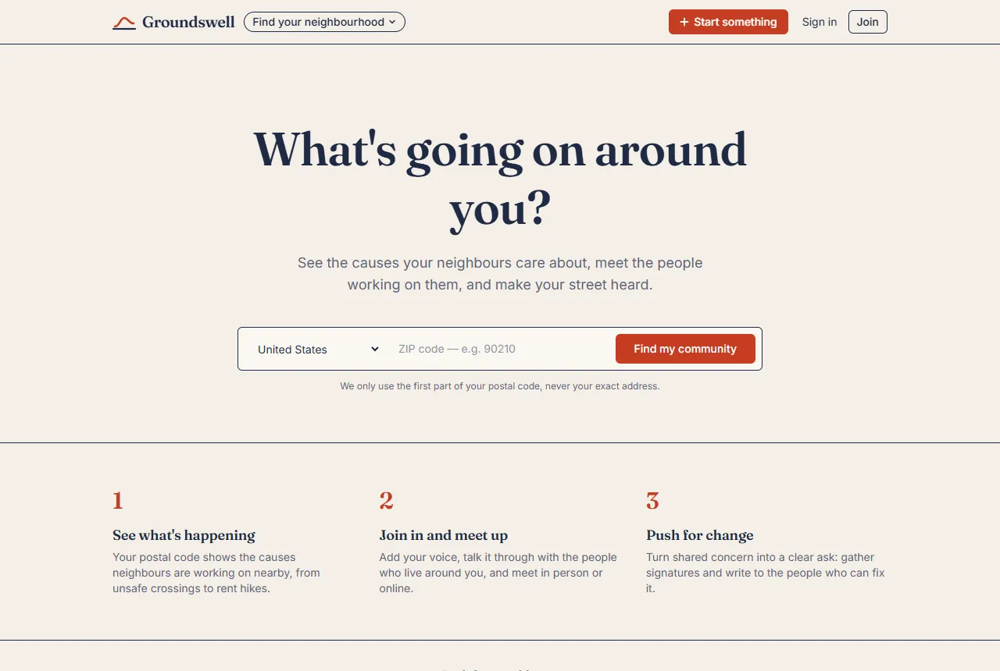

**Coming back:** once you've looked at a neighbourhood (or set a home area), the home page opens straight onto it: what's going on around there right now, recent wins, and the top causes.

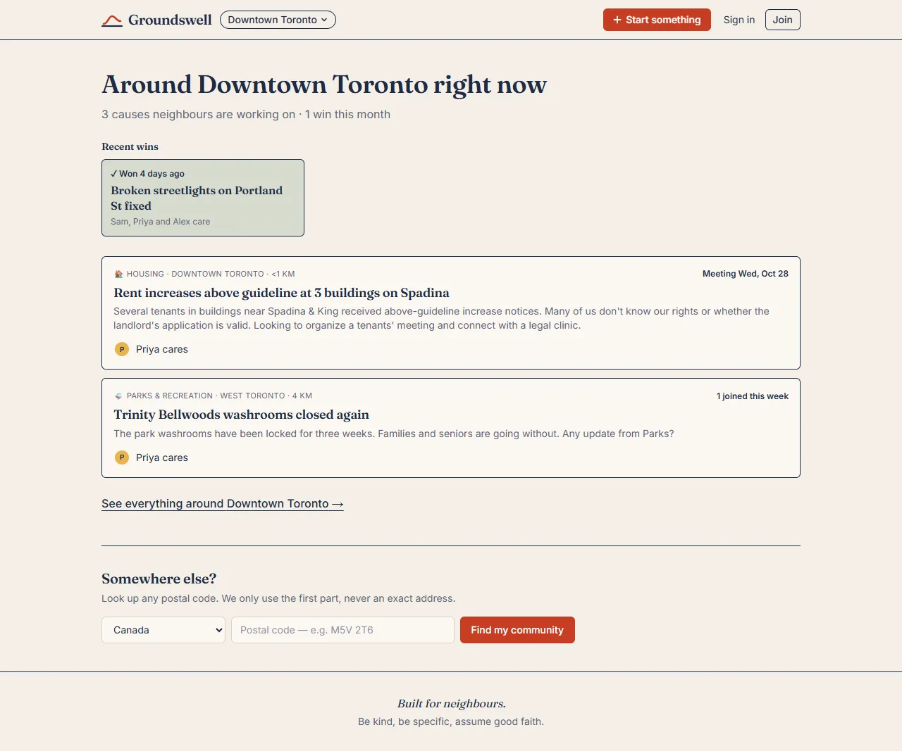

**What you can do:**
- **First visit:** pick **United States** or **Canada**, type a ZIP or postal code, and press **Find my community**. That takes you to the area page.
- **Coming back:** open any cause, see a recent win, use **See everything around …** for the full list, or look up **somewhere else** at the bottom.

**Behind the scenes:**
- Only the first part of a code is kept: the first 3 characters of a Canadian code (`M5V 2T6` → `M5V`) or the 5-digit ZIP. That's enough to find "nearby" without pinpointing anyone's home.
- "Your neighbourhood" is the last area you looked at, remembered in a small cookie holding only the area code and name. If you're signed in and haven't looked anywhere yet, it's your home area.
- Invalid codes get a friendly error rather than an empty page.

---

## 2. Area page: what's going on around a neighbourhood

`/area/ca/m5v`, `/area/us/90210`, …

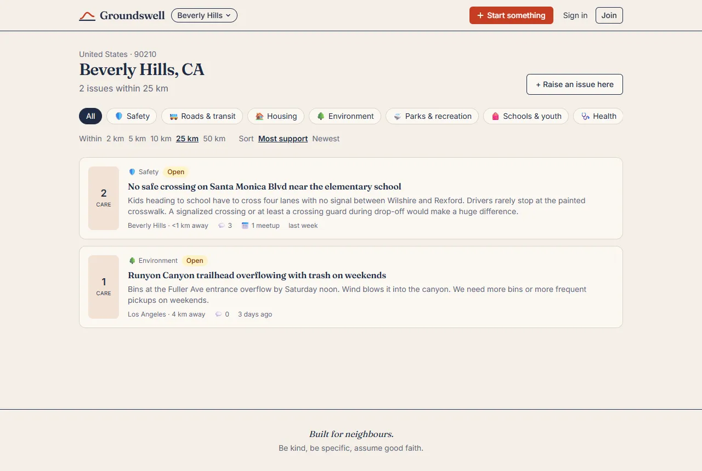

**What it's for:** the neighbourhood's noticeboard: every cause nearby, with who's involved and what's happening.

**At the top:** *"What's going on around Downtown Toronto,"* then the neighbourhood's pulse: how many neighbours are involved, events in the next 7 days, and wins in the last 30 days.

**Recent wins:** causes marked resolved in the last 30 days get their own green cards up front. Wins are the proof that working together works, so they're celebrated, not buried.

**What you can do:**
- **Filter by topic** with the tabs: Everything, Safety, Roads & transit, Housing, Environment, Parks & recreation, Schools & youth, Health, Local business, Utilities & services, Other.
- **Change the distance:** 2, 5, 10 (default), 25 or 50 km.
- **Show:** *Most support* (resolved causes sink to the bottom) or *Newest*.
- **+ Start a cause here** (or **Start something** in the top bar) starts a new one for this area.
- Visiting an area makes it "your neighbourhood" in the top bar and on the home page.
- Click any card to open the cause.

**Reading a card:** the small line on top gives the topic, place and distance. On the right is what's happening **now**, picked in this order:

| Label | When |
|---|---|
| **✓ Won** | Members confirmed the leader's "it's fixed" |
| **Meeting Wed, Oct 28** | A meetup is coming up in the next two weeks (shown in your time zone) |
| **Asking · 48 of 150 signed** | It has a campaign |
| **3 joined this week** | New people cared in the last 7 days |
| **New** | Raised in the last week |
| **Gathering / Organizing / Taking action** | Its stage (below), when none of the above applies |

Under the title: the first few people's initials and a line like *"Priya, Sam and 12 neighbours care,"* plus how many messages it has. People who've deleted their account are counted but never named.

**Behind the scenes:**
- The first time anyone looks up a code, the app asks a free service (zippopotam.us) where it is, then remembers the answer, so each code is only looked up once.
- If nothing is nearby, the page suggests looking further out or being the first to raise something.
- Causes hidden by reports or removed by a moderator never appear here.
- The moment a cause is marked resolved is recorded, so wins can be shown for 30 days (and, later, on a progress tracker).

---
## 3. A cause's space

`/causes/…` (About) · `/causes/…/chat` · `/causes/…/events` (old `/issues/…` links redirect here)

Each cause (we still call them "causes" in the app for now) is a small space of its own. A shared header sits above three tabs.

### The header: what it is, who's in, and Join

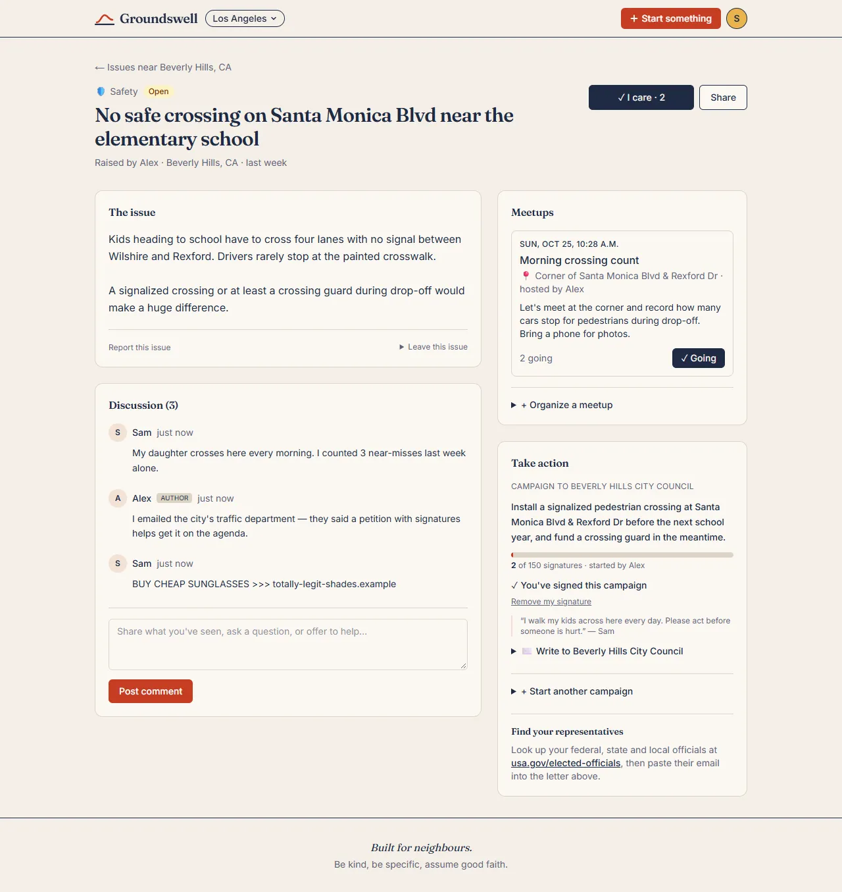

- **The small line on top:** topic, place, who started it, who leads it, and when.
- **The stage tracker:** Raised → Gathering (5+ members) → Organizing (first event held) → Taking action (a campaign, or the leader logged contacting someone) → Won, with the next step in plain words. Stages are milestones, not gates: a cause moves forward on its own as things happen, and can skip stages.
- **Banners:** *"Alex says it's fixed"* with **Yes, it's fixed** for members (see Winning below); *"Closed: …"* for a closed cause, with **Reopen** for its leader for 30 days; and, for the leader of a cause that's been quiet for 90 days, *"Is this cause still going?"* If nobody answers within 14 days, it closes as "went quiet".
- **Who's in:** the first few people's initials and *"Alex and Sam have joined."* People who've deleted their account are counted but never named.
- **Join this cause** (red) is the one big action. Joining is what used to be "I care": it adds you to the count, unlocks the chat, and starts your 24-hour chat clock (below). It doesn't need a confirmed email. Signed-out visitors are sent to sign in first.
- Once you've joined, you see **✓ Joined** and a small **Leave** link. Leaving removes your support, your RSVPs to its upcoming events and your campaign signatures, and you lose access to the chat. Your messages stay. Events you host pass to the next person going.
- **Share** opens your phone's share sheet, or copies the link on a computer.
- **The tabs:** About · Chat (🔒 if you can't see it yet, otherwise the number of messages) · Events (number coming up).

### About: the holding page

What everyone sees first:

- **The story:** what's happening, in the words of the person who raised it.
- **Next event:** if there's one coming up, a dark banner with **See event**.
- **The ask:** the campaign, if there is one: who it's aimed at, the exact request, a progress bar (*2 of 150 signed*), **Add my name** with an optional public note, **Remove my signature** if you change your mind, and **✉️ Write to …**, the letter builder:

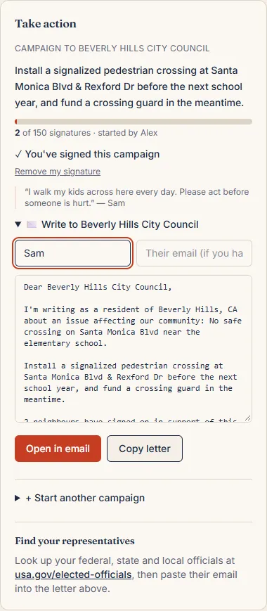

Type your name (and the recipient's email if you have it). The app writes a polite letter that includes the cause, the exact ask, how many neighbours signed, and a link back. **Open in email** opens your own email app with it filled in, or **Copy letter** copies it. Groundswell never sends these itself.

- Under **Add my name**, signers are told that their name and rough area (like M5V, from their home area) go on the petition the organizers deliver, with their note if they add one. Never their email.
- **Deliver the petition** (under each campaign, only for the people leading the cause):
  - **Download PDF:** a clean petition to hand over or attach. It has the ask, who it's to, the cause and place, the count, then every signature (name, area, date, note), with page numbers.
  - **Download spreadsheet (CSV):** the same columns. Notes starting with = + - @ are made safe, so a spreadsheet never runs them as formulas.
  - People who deleted their account aren't on it: their signatures go when they do.
  - **📬 We delivered it:** how (email, letter, meeting, in person) and when. It's logged on the timeline as *"Petition delivered to … in person, with 150 signatures"* and counts as taking action.
- **+ Start a campaign** asks three things: who can fix this, what exactly you're asking for, and a signature goal (default 100).
- **Find your representatives:** in Canada, type a full postal code to get your MP, provincial representative, councillor and mayor, with their emails. The code is passed to Open North's free "Represent" service and **not saved**. In the US, a link to usa.gov's official lookup.

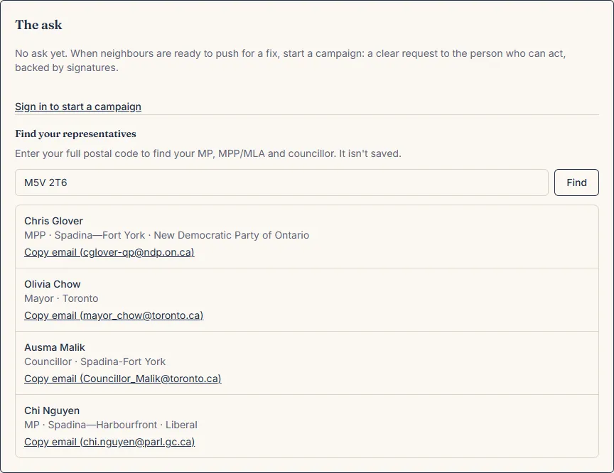

- **Timeline:** what's been done, newest first: 📨 contacted (who, how, when), 💬 they replied, ✍️ campaigns, 📅 the first meetup, 🎉 won, 🔒 closed.
- **🧭 Leading this cause** (at the top of About, only for the leader and co-leaders; members and visitors see none of it):
  - **The next step first**, with a button: *"Next: get 3 more neighbours to join"* (**Invite your group**, and the invite tools start open), *"Next: hold a first meetup"* (**Organize an event**), *"Next: start a campaign, or contact whoever should fix it"*, *"It's fixed? Propose a win"*, or *"Your win is waiting for members to confirm it"*.
  - Then the tools, in three groups: **Move it forward** (propose a win, log a contact or a reply, close), **People** (member count, where people came from, 👋 Bring your group over, co-leaders, hand over) and **The cause** (edit, who should fix it, cover image).
  - **👥 Members** (under People): everyone who's joined, when, signed the latest ask or not, going to the next event or not, and how they found it (*"from your invite"*, *"from the flyer"*). Sort newest or oldest; filter by *Hasn't signed* or *Not going*. Emails are never shown.
  - **📢 Post an announcement** (under Move it forward): at most 3 per cause a week. It's pinned at the top of the chat until replaced or unpinned. Members are told in their notifications, and by push if they have it on. People control it with *Announcements from leaders* on /me and by muting a cause. Never email or SMS.
  - The stage tracker in the header speaks to them in "you" words too (*"You can hold a first meetup to move this to Organizing"*).
  - The tools:
  - **It's fixed: propose a win.** Members are asked to confirm: 2 of them, or 1 if the cause has 3 or fewer members, within 7 days. Once confirmed it's **Won**, the date is recorded, and it shows in **Recent wins** on the neighbourhood pages for 30 days.
  - **Add to the timeline:** *we contacted someone* (moves it to Taking action) and *they replied*.
  - **Close this cause**, with a reason, for one that's stopped without a win. It stays readable; the chat becomes read-only and nobody can join or add events.
  - **Hand over leading this cause** to a member, who accepts or declines.
  - **Co-leaders:** the leader can invite up to 2 members to share leading (they accept or decline within 7 days). Co-leaders get every tool here except handing over and choosing co-leaders, can post in the chat straight away, and the header reads *"led by Sam and Alex"*. A co-leader can step down; the leader can remove one. Co-leading counts toward the 3-active-causes limit.
  - **Add a cover image** (or **Change the cover image**):
    - Choose a photo (on a phone, the camera or photo library), slide it into the wide frame, and describe it for screen readers.
    - The photo is made smaller and its hidden details (like location) are removed *on the device*, before it's uploaded.
    - It shows across the top of the cause, on its card on the neighbourhood board, and as the picture when the link is shared.
    - Events get covers the same way, from the event page; the host or the cause's leaders can set one.
    - Admins see **Remove image (moderator)** under any cover. New accounts can't add images on their first day.
- Everyone else sees **Report this cause** at the bottom of About.
- **📣 Spread the word** (on About for any open cause, and on every upcoming event; anyone can use it):
  - **Print a flyer:** one page (Letter or A4) with:
    - the cover image and the title in big type;
    - a big QR code and a short link to type (`groundswell.hahnsolo.ca/go/k7m2qp`);
    - for events, the day, time, place and the host's first name. Online events never show the video link.
    - Tick **Tear-off strips** for a row of small QR codes along the bottom.
  - **Share images:** a square post, a story and a wide card, each with the QR code and short link. Download one, or tap **Share** on a phone to post it straight from the share sheet.
  - **Where are you posting it?** tags the images and the link (Instagram, WhatsApp, Facebook, email, text…).
  - The people leading the cause, and an event's host, see **Where people came from**, like *"9 people came from the flyer, 14 from WhatsApp"*. Each person counts once, from the first tagged link they used.
- **👋 Bring your group over** (on About, for the leader and co-leaders of an open cause):
  - **Your invite link** (`groundswell.hahnsolo.ca/i/k7m2qp`), one per person leading it, with *"14 people have joined from your invite"*.
  - **The message:** ready-written and editable, with **Share to WhatsApp**, **Text** and **Email** buttons that open your own apps. Paste it into a WhatsApp group to invite everyone at once.
  - **Use my contact list:** pick a spreadsheet (Excel .xlsx or .csv) with names, emails and/or phone numbers. Columns are found by their usual names (Name, First name, Email, Mobile, Phone…).
    - Emails: **Copy all addresses**, or **Open in my email** with everyone in BCC (big lists open in groups of 40).
    - Phone numbers: a checklist, each with **WhatsApp** and **Text** buttons and a message that starts with their first name. Ticks are kept on that device.
    - The file is read in the browser only. It's never uploaded or stored, and Groundswell never emails or texts the people on it (consent and anti-spam law: CASL, the TCPA).

**Rules:** signing and starting a campaign need a confirmed email; campaigns are limited to 5 an hour (1 for new accounts).

### Chat: members only, with a day to settle in

The conversation replaces the old "Discussion" comments, which carried over as the start of each chat.

| Who you are | What you see |
|---|---|
| Not signed in, or not a member | *"The chat is for neighbours who've joined"*, with **Join this cause** |
| Joined in the last 24 hours | The whole chat, plus *"You can post from Wednesday 12:52 p.m."* |
| Member for 24 hours or more | The chat and a message box |
| The person who raised the cause | Can post straight away |
| An admin who hasn't joined | Can read (to moderate) but not post |

| Not a member | New member (first 24 hours) |
|---|---|
| 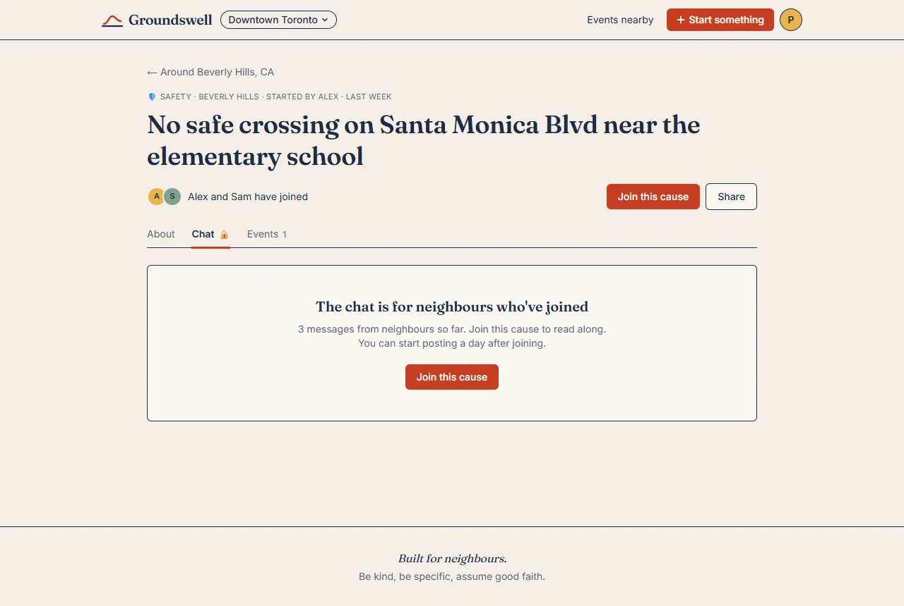 | 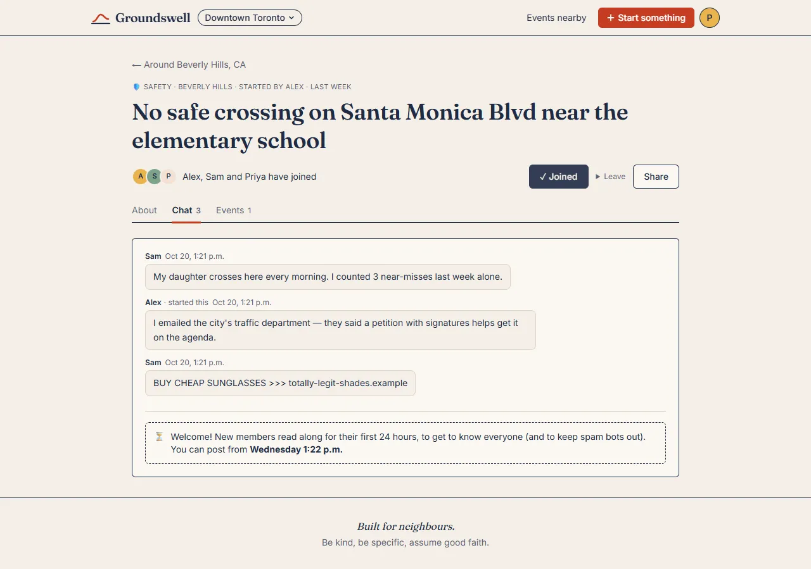 |

A member past the wait:

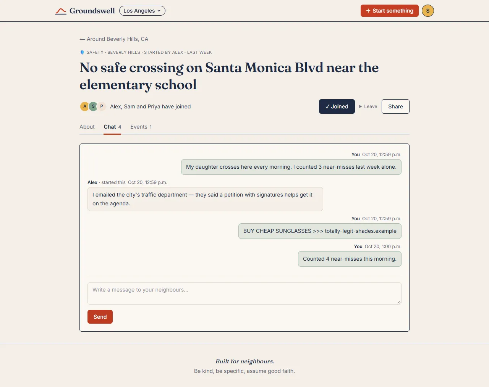

- Your own messages sit on the right in green; everyone else's on the left. Messages from the same person in a row are grouped (the name shows once), each bubble has its time, and **Today**, **Yesterday** or the day separates days.
- **On a phone** the chat fills the screen like a group chat: a one-line header (**←** back to the cause, and its title), the messages, and the message box pinned to the bottom, above the keyboard. It opens at the newest message and stays there as new ones arrive. If you've scrolled up to read, **New messages ↓** appears instead of jumping you down. On a computer it's a roomy panel under the cause's header.
- **The message box** starts as one line and grows as you type. **Send** is the round arrow button. On a computer, Enter sends (Shift+Enter for a new line); on a phone, Enter is a new line.
- **⋯ on each message** opens a small menu: **Edit** your own message (for 15 minutes) or **Report** someone else's.
- **For the people leading the cause,** the menu also has:
  - **Hide:** others see *"Hidden by the people leading this cause"*; the author still sees their message, with a note. It also files a report for moderators. **Unhide** takes it back.
  - **Remove from this cause** (also in the Members list): asks why. The person leaves the cause, can't rejoin, sign or RSVP there, and is told why on the page and in their notifications. Their messages stay.
  - Not on moderators' messages, and co-leaders are removed under Co-leaders. Moderators see all of it under **What leaders did** in the queue, and can undo it.
- **Why the 24-hour wait:** it gives newcomers a day to get a feel for the conversation, and it stops bots that join and spam straight away. Reading, RSVPing and signing aren't held back, only posting in the chat.
- **Other rules:** a confirmed email is needed to post. New accounts (first 24 hours) can post 10 messages an hour and no links; established accounts 60 an hour with up to 3 links. The same message twice within 10 minutes is refused.
- The server checks all of this on every message, so the rules can't be dodged by skipping the page.

### Events

Every event belongs to a cause. The Events tab lists them, each with the date and time **in your own time zone**, the place (or "Online"), who's hosting, how many are going, and **I'll be there** (it becomes **✓ Going**, or **Full** if there's a capacity and it's reached).

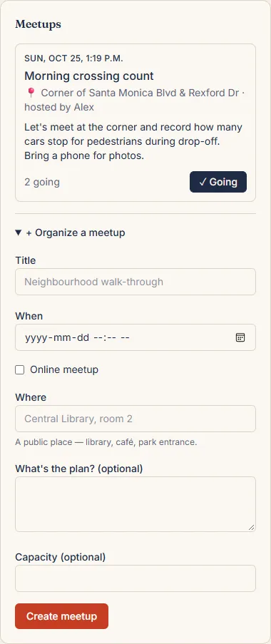

- **+ Organize an event** opens the form: title, when, where (a public place is suggested), an optional plan, and an optional capacity. Tick **Online meetup** and *Where* becomes *Video link*. **The link is only shown to people going**, so random visitors can't drop into the call.
- **Repeats** (on the same form): just once, every week, every 2 weeks, or every month on the same weekday (the 2nd Tuesday stays the 2nd Tuesday; a 5th becomes the last), for a number of times or until a date, up to 26. It stays at the same time on the clock when the clocks change.
  - Each meeting is its own event with its own page: people say they're going per meeting, and each gets its own reminder.
  - The Events tab shows the next 4 (*"2 more dates after this"*), and Events nearby the next 2.
  - The host can edit **just this meeting** or **this and all future meetings**, and under **Cancel a meeting**, cancel just this one or this and all future ones. Everyone going is told.
- The host is automatically going and sees **✓ Hosting**.
- **Can't host it?** → **Step down as host** passes the event to the first person who RSVP'd (who gets a notification), or cancels it if nobody else is going. The event then shows *"hosted by Sam (took over)."*

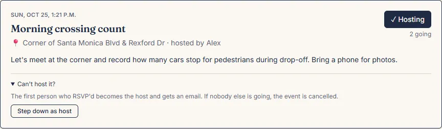

**Rules:** confirmed email needed to organize; 10 events an hour (2 for new accounts); the time must be in the future. Only events still to come (and ones that started in the last 6 hours) are listed.

### An event's own page

`/events/…`. Click any event's title (or **See event** on About) to open it.

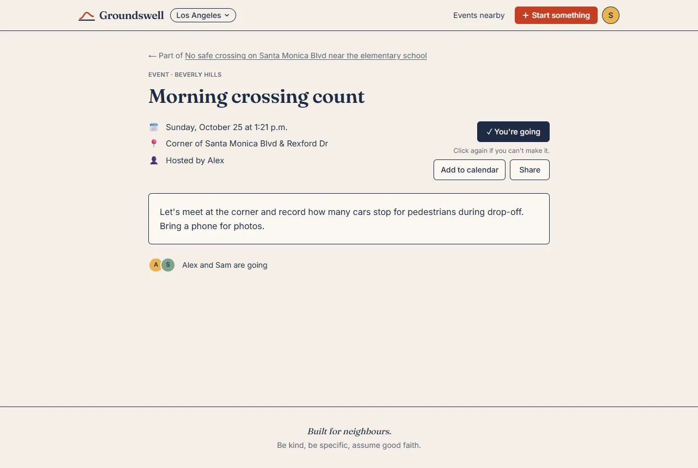

- **Up top:** *"← Part of …"*, a link back to the cause it belongs to.
- **When, where, who's hosting.** Times are always shown in **your own** time zone. For online events, the video link only appears once you've said you're going.
- **I'll be there** (or **✓ You're going**; click again if you can't make it). Signed-out visitors are sent to sign in and then straight back.
- **Add to calendar** downloads the event for Google Calendar, Apple Calendar or Outlook. It assumes two hours, since events don't have an end time yet. For online events the file says "Online (link on the event page)" rather than including the link.
- **Who's going:** *"Alex and Sam are going,"* and places left if there's a capacity.
- **Hosts** get **Can't host it?** here too.
- **✉️ Email my list an update** (hosts): opens your own email app with a message ready, and you send it yourself. Optionally add your own list as a spreadsheet (.xlsx or .csv), read on your device only, and the addresses go in BCC (big lists open in groups of 40). Groundswell doesn't send it, and members' emails are never shared.

### Events nearby

`/events`, also **Events nearby** in the top bar (on wider screens) and **Events around here →** on every area page.

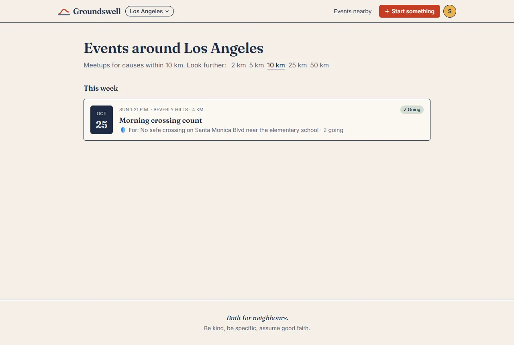

Every upcoming event for causes around your neighbourhood, split into **This week** and **Later** (up to 60 days ahead), each with its date, time, place, distance, cause and how many are going. **✓ Going** marks the ones you've said yes to. Use **Look further** to widen from 10 km up to 50 km. If we don't know your neighbourhood yet, it asks for a postal code first.

---
## 4. Start a cause

`/causes/new` (from **Start something** in the top bar, or **+ Start a cause here** on an area page)

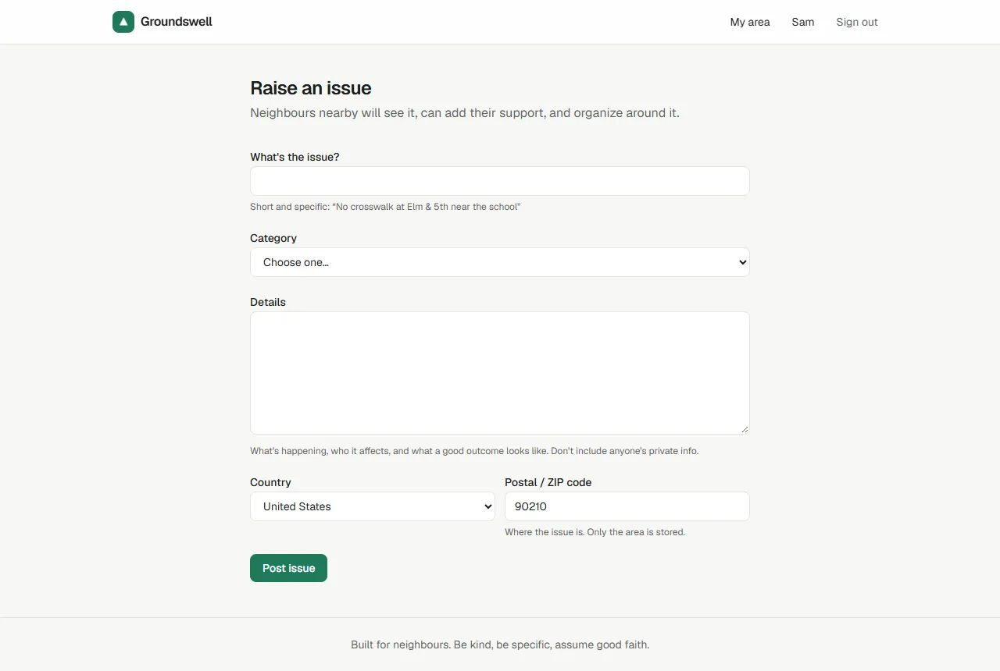

- **What's the cause?** A short, specific title (8–120 characters).
- **Category:** one of the ten.
- **Details:** what's happening, who it affects, and what a good outcome looks like (20–5,000 characters). The hint reminds people not to include anyone's private information.
- **Country and postal code:** filled in from the area you came from. Only the area is stored.
- **Start this cause** creates it, makes the author its first member, and opens the new cause's page.

**Rules:** confirmed email needed; 10 causes an hour (2 for new accounts); new accounts can't include links.

**Leading at most 3:** each person can lead up to 3 active causes at once (`MAX_LEADING_CAUSES` in `src/lib/leading-limit.ts`). Won and closed causes don't count. At the limit, this page explains why and lists their causes, with the ways out: mark one won, close one, or hand one over. The same limit applies to accepting a hand-over and to reopening a closed cause. Nobody loses causes they already lead; admins aren't limited.

---

## 5. Join, sign in and forgot password

| Join (`/signup`) | Sign in (`/signin`) |
|---|---|
| 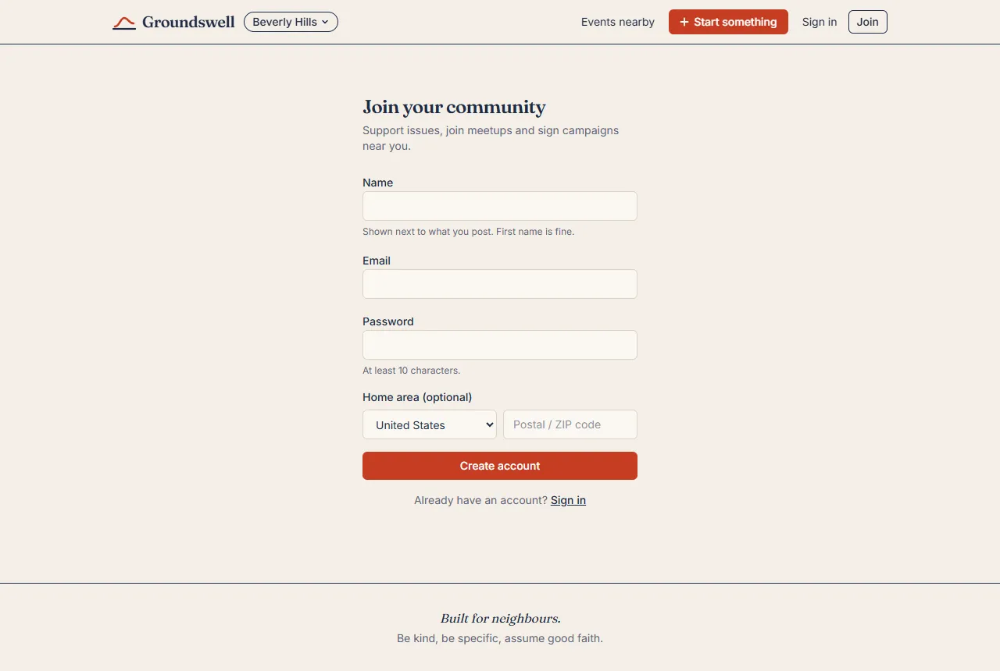 | 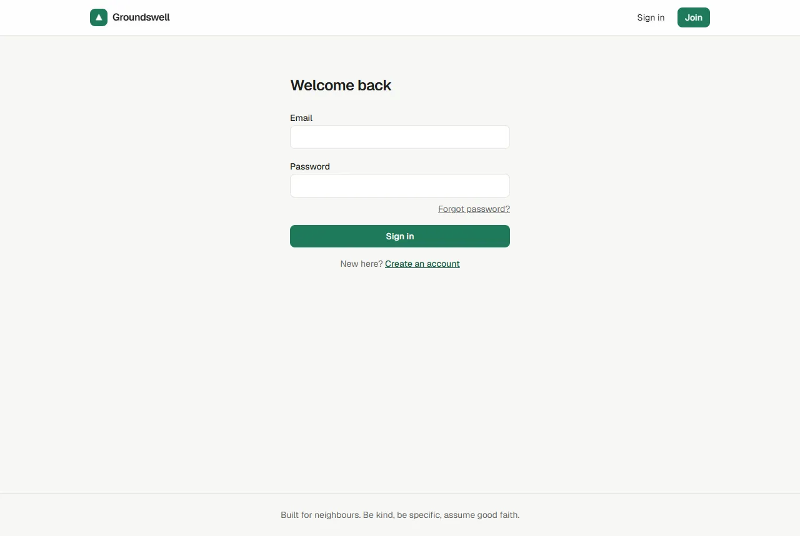 |

**Join** asks for a name (shown on posts; a first name is fine), email, a password of at least 10 characters, and an optional home area. Then:

1. The account is created and you're signed in straight away.
2. A **"Confirm your email"** message is sent (on your PC it's printed in the terminal instead). The link works for 48 hours.
3. Until you click it, you can browse, support causes and RSVP, but not post, sign or report. The yellow bar reminds you.

**Sign in** takes you back to the page you were on. After 10 wrong tries on one account (or 20 from one connection) within 15 minutes, it asks you to wait.

**Forgot password?** (`/forgot-password`) emails a reset link that works for 1 hour. It always answers *"If there's an account for that email, a reset link is on its way,"* whether or not the address is registered, so nobody can use it to find out who's a member. Setting a new password signs you out on every device.

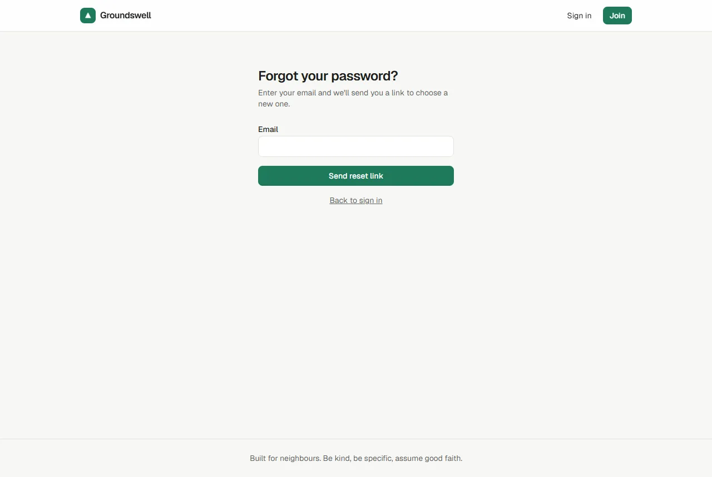

**Coming later:** once their keys are added, **Sign in with Google** and **Sign in with Apple** buttons appear on both forms automatically, and the Cloudflare "are you human?" check appears too (usually invisible). See [Security and spam](security-and-spam.md).

---

## 6. Your activity (`/me`)

Click your name in the top bar.

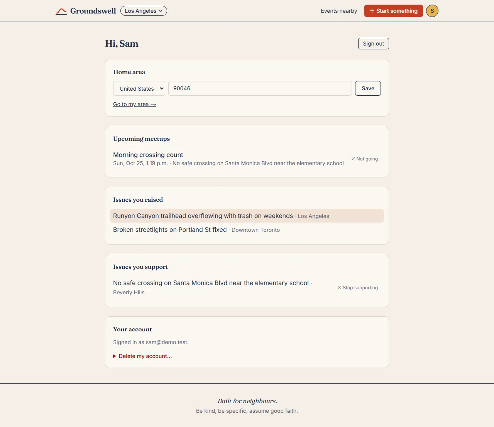

- **Sign out** at the top right.
- **Needs you** (only when something does, at the top): each item links straight to the right place.
  - a request to lead or co-lead a cause, to accept or decline;
  - *"Is … still going?"* for a quiet cause you lead;
  - a win to confirm on a cause you've joined, or your own win waiting (*"1 of 2 confirmations"*);
  - reports on a cause you lead, waiting for a moderator;
  - events you're hosting in the next 7 days;
  - new members since you last opened a cause you lead (the past week, the first time).
- **Causes you lead** (as leader or co-leader), with the stage and member count. *"Nothing needs you right now"* when the list above is empty.
- **Home area:** set or change your postal code. The top bar falls back to it when you haven't looked at another area.
- **Upcoming meetups** you've RSVP'd to, with times in your time zone. **✕ Not going** cancels your RSVP. Meetups you host are tagged **Hosting**, with a **Manage** link to the meetup (stepping down is confirmed there).
- **Causes you started** that you don't lead any more (you handed them over), and any a moderator hid or removed, with an **Under review** or **Removed** tag.
- **Privacy:** **Show my name on causes I join** (on by default). Off, you're "A neighbour" in chats, signatures and who's going, and just counted elsewhere. The people leading each cause and moderators still see your name, it still goes on a petition you sign, and leading or hosting stays public.
- **Notifications** (`/me#notifications`): your latest 30, the same ones as under your name icon. Seeing them here marks them read. They're kept for 90 days.
- **Causes you've joined** (other than ones you lead), each with **Mute** (no notifications about that cause) and **✕ Leave**.
- **Notifications on this device** (`/me#push`): **Turn on notifications on this device**. The kinds you've chosen below then also come as phone or computer notifications, and tapping one opens the right page. It's free standard web push. It works on Android and computers in any modern browser, and on iPhones once Groundswell is on the home screen (there's a short how-to). Turning it off, or signing out, stops it on that device. After you join a cause, a quiet offer also appears on the cause page, until you answer it.
- **What you hear about** (`/me#email`): which kinds of notifications you get. Defaults: **Event reminders** (the day before an event you're going to), **"Is it fixed?"** (a leader asks members to confirm a win), **Wins** (a cause you joined is won) and **New members** (daily, for causes you lead) and **Announcements from leaders** are on; **Chat summary** (daily, new messages in your causes) is off. Requests to lead or co-lead, taking over as host and being removed always reach you.
- **Email is only for confirming your address and resetting your password.** Everything else is a notification, which keeps Groundswell within Resend's free 100 emails a day. Reminders and summaries go out with the daily job at 09:00 UTC. To email people again, set `NOTIFICATION_EMAILS` in `src/lib/notify-rules.ts`; those emails carry unsubscribe links, and they get 60 of the 100 a day.
- **Your account:** your sign-in email, and **Delete my account…** (below).
- **Admins also see** a **Moderation queue** box at the top with the number of open reports.

### Deleting your account

**Delete my account…** opens a plain explanation of what will happen, and asks for your password:

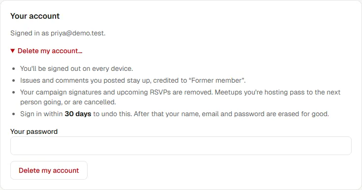

After confirming, you're signed out everywhere and land on this page:

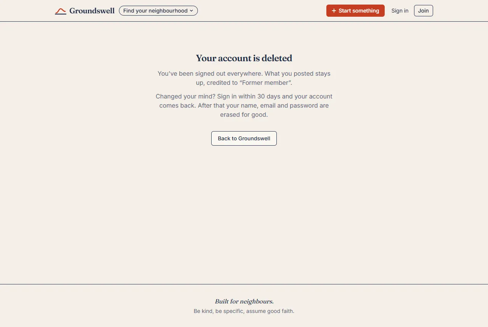

- **Right away:** everything you posted shows **"Former member"** instead of your name. Your campaign signatures and upcoming RSVPs are removed, and meetups you were hosting are handed on or cancelled. Your "I care" clicks stay as anonymous numbers.
- **Changed your mind?** Sign in within **30 days** and the account comes back, with a "Welcome back" note. (Removed signatures and RSVPs aren't restored.)
- **After 30 days:** your name, email, password and home area are erased for good by the daily clean-up job. Your posts stay, so the conversations still make sense, and your email is free to sign up again.

---

## 7. Reporting and the moderation queue (admins)

### How reporting works

1. Any member with a confirmed email can click **Report** on a cause or a comment (not their own).
2. The report goes into the moderation queue. Up to 20 reports an hour per person.
3. If **3 different accounts that are over a day old** report the same thing, it's **hidden automatically** until an admin decides. The author still sees it, with a note that it's under review.

### The moderation queue

`/admin/reports`. Only admins can see it; everyone else gets "page not found." (How to make someone an admin: [Day to day](day-to-day.md#making-someone-an-admin).)

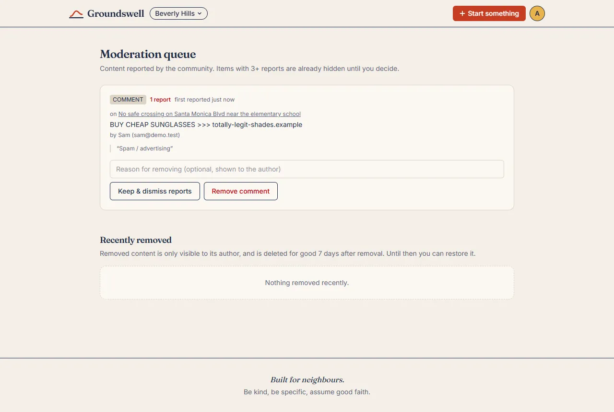

Each reported item shows its type, number of reports, when it was first reported, the content and who wrote it, and the reporters' reasons. Then:

- **Keep & dismiss reports** (or **Restore** if it was auto-hidden): it stays, and the reports are closed.
- **Remove message / cause:** optionally type a reason first (the author will see it), then click.

### After removing: undo for 7 days

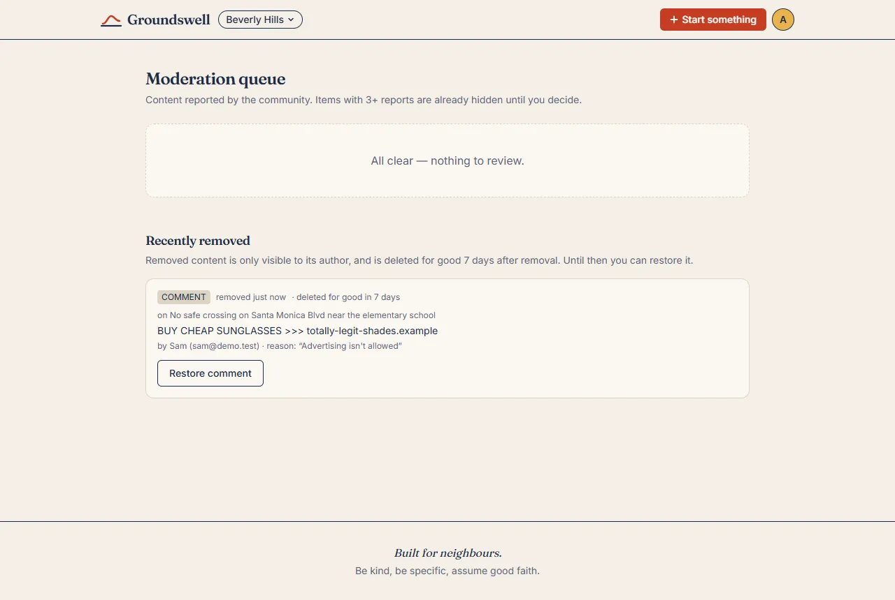

Removed content moves to **Recently removed**, which shows when it was removed, when it will be deleted for good, the reason, and a **Restore** button.

Meanwhile, the **author** sees this under their removed comment (or at the top of a removed cause). Nobody else sees the content at all:

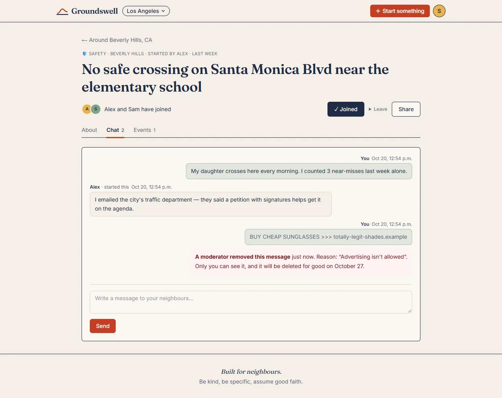

After **7 days**, the daily clean-up job on Vercel deletes it permanently. Deleting a cause also deletes its comments, meetups and campaigns. Every decision (kept, removed, restored) is recorded with who did it and when.

---

## 8. On a phone, and installing the app

The whole site is designed to work on phones first:

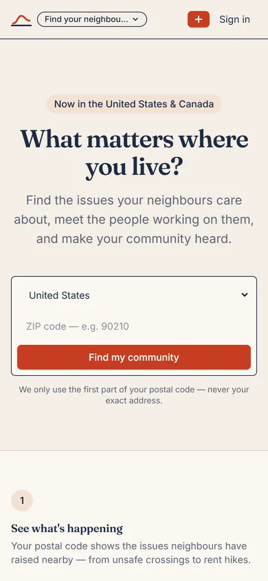
&nbsp;
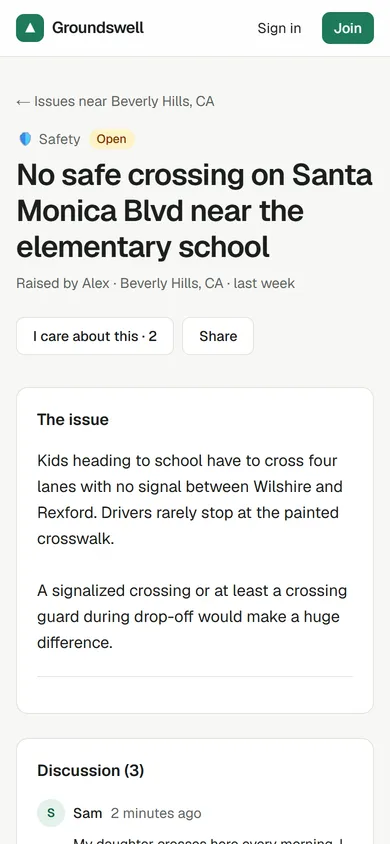

**Installing:** Groundswell can be added to a phone's home screen like an app (it's a "PWA"):

- **Android / Chrome / Edge:** a small "Get the Groundswell app" card appears at the bottom with an **Install** button.
- **iPhone (Safari):** the card explains *Share → Add to Home Screen*, since Apple doesn't allow a button.
- Dismiss it with ✕ and it won't come back on that device.

Installed, it opens full-screen with its own icon. It only stores the app's design files on the phone, never pages or anyone's data, so nobody sees stale or someone else's information.

---

## 9. Small pages

| Not found | Offline |
|---|---|
| 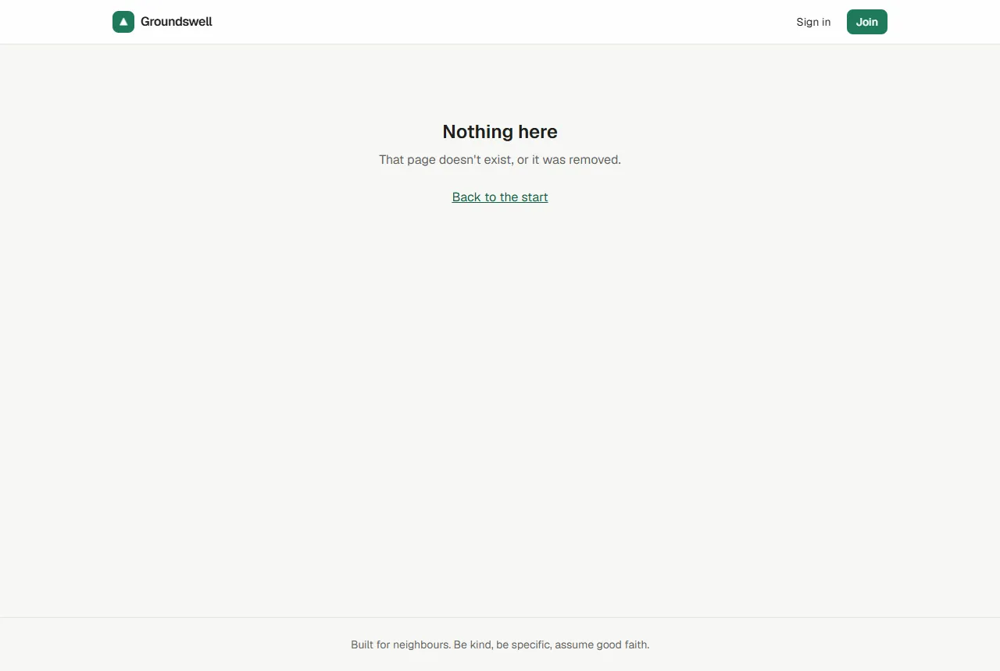 | 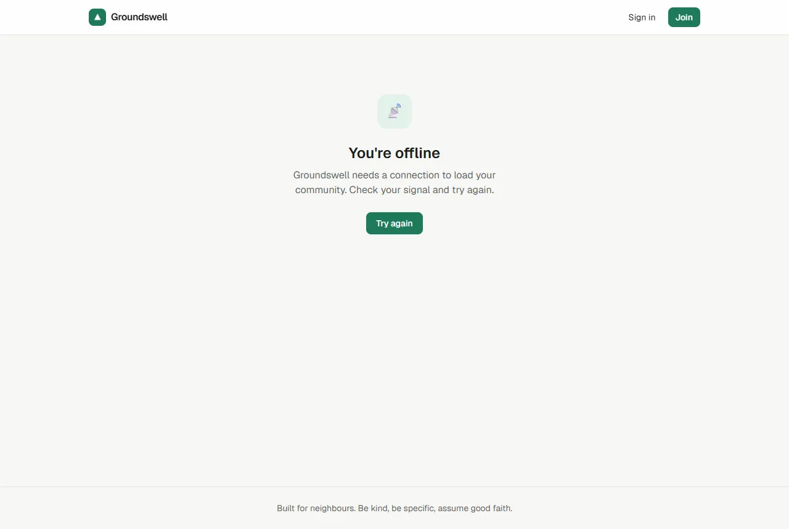 |

- **Not found** appears for a mistyped address, a deleted or removed cause, or a non-admin trying `/admin/reports`.
- **You're offline** appears when the installed app is opened without a connection, instead of the browser's error page.

---

## 10. Who can do what

| Action | Visitor | Signed in | Email confirmed | Cause author | Admin |
|---|:-:|:-:|:-:|:-:|:-:|
| Browse areas, causes, meetups, campaigns | ✓ | ✓ | ✓ | ✓ | ✓ |
| Look up representatives | ✓ | ✓ | ✓ | ✓ | ✓ |
| Join a cause, RSVP | | ✓ | ✓ | ✓ | ✓ |
| Read a cause's chat | | members | members | ✓ | ✓ (to moderate) |
| Post in a cause's chat | | | members of 24 h+ | ✓ | members of 24 h+ |
| Raise causes, organize events, start campaigns | | | ✓ | ✓ | ✓ |
| Sign campaigns, report content | | | ✓ | ✓ | ✓ |
| Remove own signature or RSVP; leave a cause | | ✓ | ✓ | ✓ | ✓ |
| Step down as an event's host | | ✓ (host) | ✓ (host) | ✓ (host) | ✓ (host) |
| Delete own account | | ✓ | ✓ | ✓ | ✓ |
| Change a cause's status | | | | ✓ | |
| See their own hidden/removed posts (with a notice) | | | | ✓ | |
| Moderation queue: keep, remove, restore | | | | | ✓ |

The posting limits, link rules and everything else that protects the site are explained in [Security and spam](security-and-spam.md).

---

*To refresh these screenshots after a design change: reseed the dev database (`npm run db:seed`), run the dev server, and retake the pictures at 1280 px wide (phones at 390 px). Save them as WebP in `docs/images/walkthrough/`, keeping the same file names.*
