# Walkthrough: every page, with pictures

A tour of Groundswell from a visitor's point of view: what each page is for, what people can do there, and the rules working behind it.

The screenshots come from the **dev site with demo data** (Alex, Sam and Priya are made-up accounts from `prisma/seed.ts`). The live site looks the same, just with real posts.

**Contents**

1. [Home page](#1-home-page)
2. [Area page: what's going on around a neighbourhood](#2-area-page-whats-going-on-around-a-neighbourhood)
3. [A cause's space](#3-a-causes-space): the heart of the app
   - [The header: what it is, who's in, and Join](#the-header-what-it-is-whos-in-and-join)
   - [About: the holding page](#about-the-holding-page)
   - [Chat: members only, with a day to settle in](#chat-members-only-with-a-day-to-settle-in)
   - [Events](#events)
4. [Raise an issue](#4-raise-an-issue)
5. [Join, sign in, forgot password](#5-join-sign-in-and-forgot-password)
6. [Your activity (`/me`)](#6-your-activity-me), including [deleting your account](#deleting-your-account)
7. [Reporting and the moderation queue (admins)](#7-reporting-and-the-moderation-queue-admins)
8. [On a phone, and installing the app](#8-on-a-phone-and-installing-the-app)
9. [Small pages: not found, offline](#9-small-pages)
10. [Who can do what: summary table](#10-who-can-do-what)

---

## The top bar (on every page)

- **The wave logo and "Groundswell"** go back to the home page.
- **Your neighbourhood** (e.g. "Downtown Toronto ▾"): the last area you looked at, or your home area. Click it to jump back there or look up another postal code. It's remembered in a small cookie that holds only the area code and its name.
- **+ Start something** (red, the one loud button) raises a new issue in the neighbourhood you're looking at. On a phone it's just a **+**.
- **Signed out:** **Sign in** and **Join**.
- **Signed in:** a circle with **your initial**, which goes to your activity page. **Sign out** is at the top of that page.
- **Email not confirmed yet:** a yellow bar under the top bar says *"Confirm your email (…) to post issues, comments and meetups"* (this applies to chat messages too), with a button to resend the link (at most 3 times an hour).

---

## 1. Home page

`/`

**First visit:** a short welcome and a postal code box.

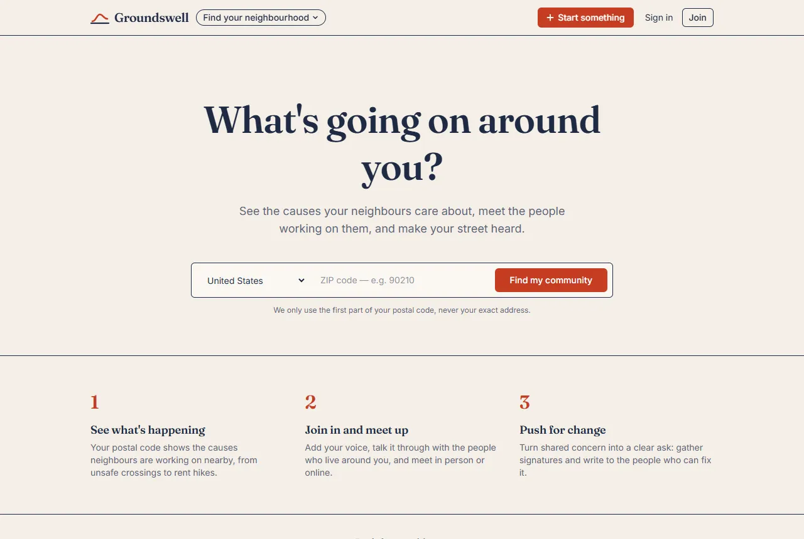

**Coming back:** once you've looked at a neighbourhood (or set a home area), the home page opens straight onto it: what's going on around there right now, recent wins, and the top causes.

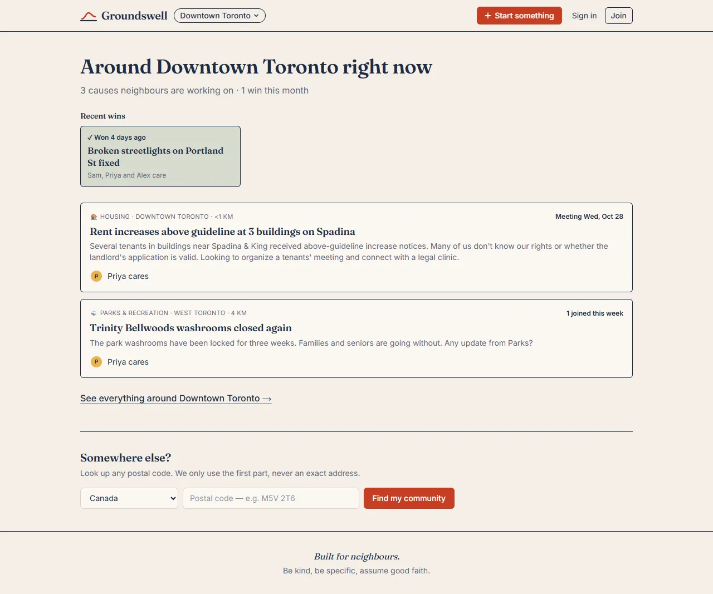

**What you can do:**
- **First visit:** pick **United States** or **Canada**, type a ZIP or postal code, and press **Find my community**. That takes you to the area page.
- **Coming back:** open any cause, see a recent win, use **See everything around …** for the full list, or look up **somewhere else** at the bottom.

**Behind the scenes:**
- Only the first part of a code is kept: the first 3 characters of a Canadian code (`M5V 2T6` → `M5V`) or the 5-digit ZIP. That's enough to find "nearby" without pinpointing anyone's home.
- "Your neighbourhood" is the last area you looked at, remembered in a small cookie holding only the area code and name. If you're signed in and haven't looked anywhere yet, it's your home area.
- Invalid codes get a friendly error rather than an empty page.

---

## 2. Area page: what's going on around a neighbourhood

`/area/ca/m5v`, `/area/us/90210`, …

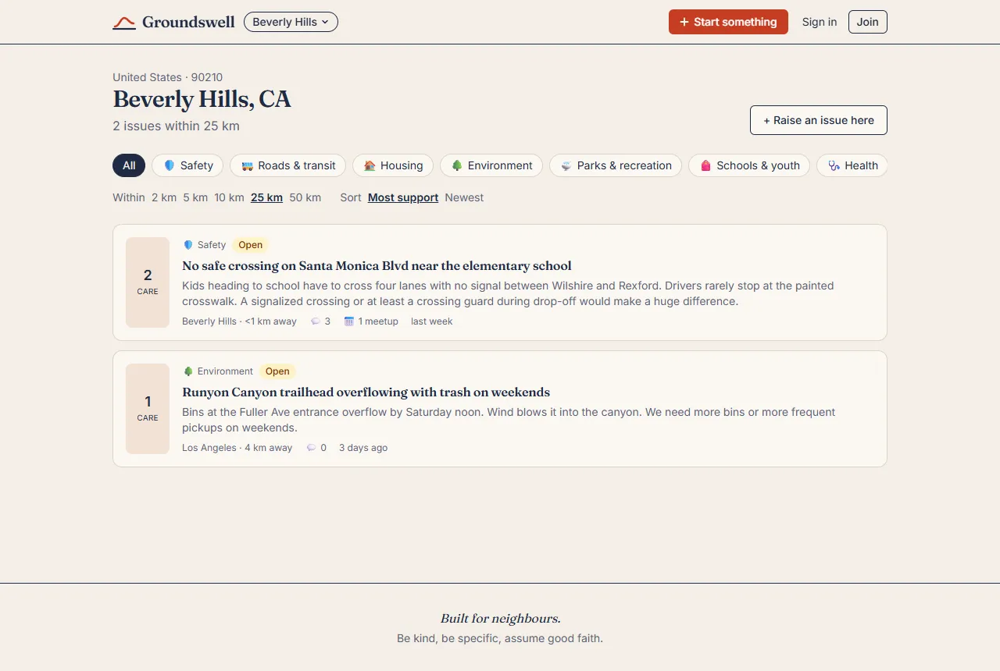

**What it's for:** the neighbourhood's noticeboard: every cause nearby, with who's involved and what's happening.

**At the top:** *"What's going on around Downtown Toronto,"* then the neighbourhood's pulse: how many neighbours are involved, events in the next 7 days, and wins in the last 30 days.

**Recent wins:** causes marked resolved in the last 30 days get their own green cards up front. Wins are the proof that working together works, so they're celebrated, not buried.

**What you can do:**
- **Filter by topic** with the tabs: Everything, Safety, Roads & transit, Housing, Environment, Parks & recreation, Schools & youth, Health, Local business, Utilities & services, Other.
- **Change the distance:** 2, 5, 10 (default), 25 or 50 km.
- **Show:** *Most support* (resolved causes sink to the bottom) or *Newest*.
- **+ Raise an issue here** (or **Start something** in the top bar) starts a new one for this area.
- Visiting an area makes it "your neighbourhood" in the top bar and on the home page.
- Click any card to open the cause.

**Reading a card:** the small line on top gives the topic, place and distance. On the right is what's happening **now**, picked in this order:

| Label | When |
|---|---|
| **✓ Won** | The person who raised it marked it resolved |
| **Meeting Wed, Oct 28** | A meetup is coming up in the next two weeks (shown in your time zone) |
| **Asking · 48 of 150 signed** | It has a campaign |
| **3 joined this week** | New people cared in the last 7 days |
| **New** | Raised in the last week |
| **Being worked on** | Its author set that status and none of the above applies |

Under the title: the first few people's initials and a line like *"Priya, Sam and 12 neighbours care,"* plus how many messages it has. People who've deleted their account are counted but never named.

**Behind the scenes:**
- The first time anyone looks up a code, the app asks a free service (zippopotam.us) where it is, then remembers the answer, so each code is only looked up once.
- If nothing is nearby, the page suggests looking further out or being the first to raise something.
- Issues hidden by reports or removed by a moderator never appear here.
- The moment a cause is marked resolved is recorded, so wins can be shown for 30 days (and, later, on a progress tracker).

---
## 3. A cause's space

`/issues/…` (About) · `/issues/…/chat` · `/issues/…/events`

Each cause (we still call them "issues" in the app for now) is a small space of its own. A shared header sits above three tabs.

### The header: what it is, who's in, and Join

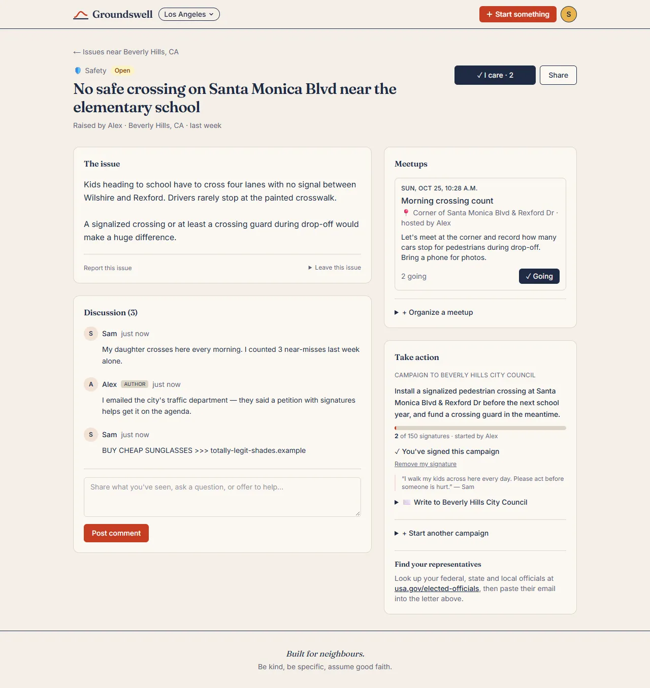

- **The small line on top:** topic, place, who started it and when, plus **✓ Won** once it's resolved.
- **Who's in:** the first few people's initials and *"Alex and Sam have joined."* People who've deleted their account are counted but never named.
- **Join this cause** (red) is the one big action. Joining is what used to be "I care": it adds you to the count, unlocks the chat, and starts your 24-hour chat clock (below). It doesn't need a confirmed email. Signed-out visitors are sent to sign in first.
- Once you've joined, you see **✓ Joined** and a small **Leave** link. Leaving removes your support, your RSVPs to its upcoming events and your campaign signatures, and you lose access to the chat. Your messages stay. Events you host pass to the next person going.
- **Share** opens your phone's share sheet, or copies the link on a computer.
- **The tabs:** About · Chat (🔒 if you can't see it yet, otherwise the number of messages) · Events (number coming up).

### About: the holding page

What everyone sees first:

- **The story:** what's happening, in the words of the person who raised it.
- **Next event:** if there's one coming up, a dark banner with **See event**.
- **The ask:** the campaign, if there is one: who it's aimed at, the exact request, a progress bar (*2 of 150 signed*), **Add my name** with an optional public note, **Remove my signature** if you change your mind, and **✉️ Write to …**, the letter builder:

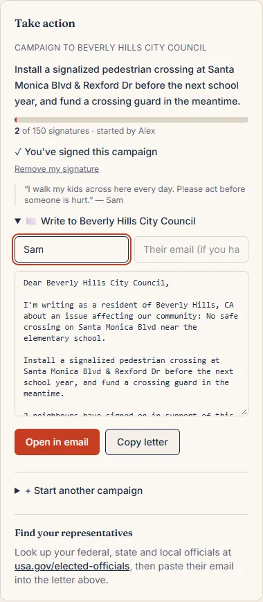

Type your name (and the recipient's email if you have it). The app writes a polite letter that includes the issue, the exact ask, how many neighbours signed, and a link back. **Open in email** opens your own email app with it filled in, or **Copy letter** copies it. Groundswell never sends these itself.

- **+ Start a campaign** asks three things: who can fix this, what exactly you're asking for, and a signature goal (default 100).
- **Find your representatives:** in Canada, type a full postal code to get your MP, provincial representative, councillor and mayor, with their emails. The code is passed to Open North's free "Represent" service and **not saved**. In the US, a link to usa.gov's official lookup.

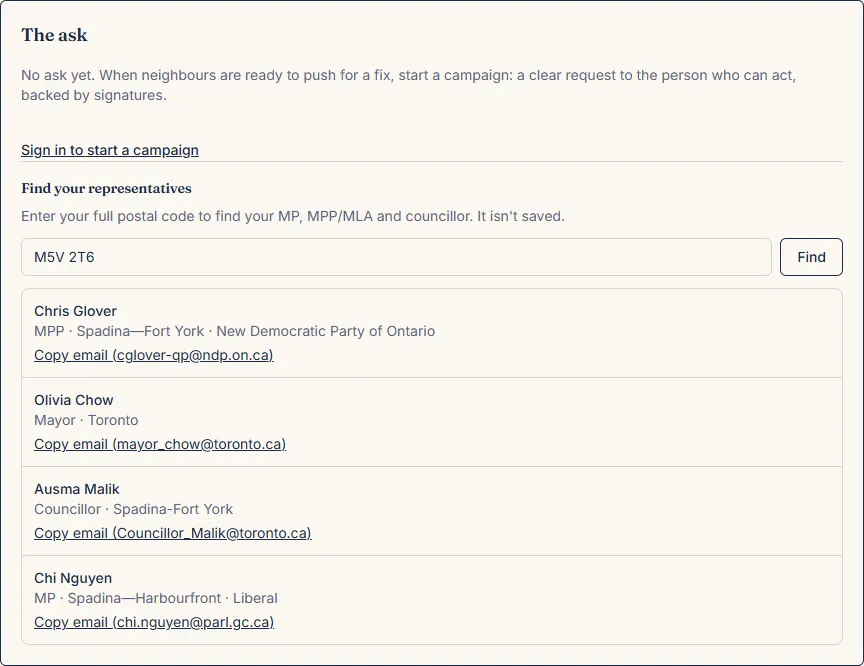

- **At the bottom:** the person who raised it can set *Open*, *Being worked on* or *Won / resolved*. Marking it won records the date, and it shows in **Recent wins** on the neighbourhood pages for 30 days. Everyone else sees **Report this issue** there instead.

**Rules:** signing and starting a campaign need a confirmed email; campaigns are limited to 5 an hour (1 for new accounts).

### Chat: members only, with a day to settle in

The conversation replaces the old "Discussion" comments, which carried over as the start of each chat.

| Who you are | What you see |
|---|---|
| Not signed in, or not a member | *"The chat is for neighbours who've joined"*, with **Join this cause** |
| Joined in the last 24 hours | The whole chat, plus *"You can post from Wednesday 12:52 p.m."* |
| Member for 24 hours or more | The chat and a message box |
| The person who raised the cause | Can post straight away |
| An admin who hasn't joined | Can read (to moderate) but not post |

| Not a member | New member (first 24 hours) |
|---|---|
| 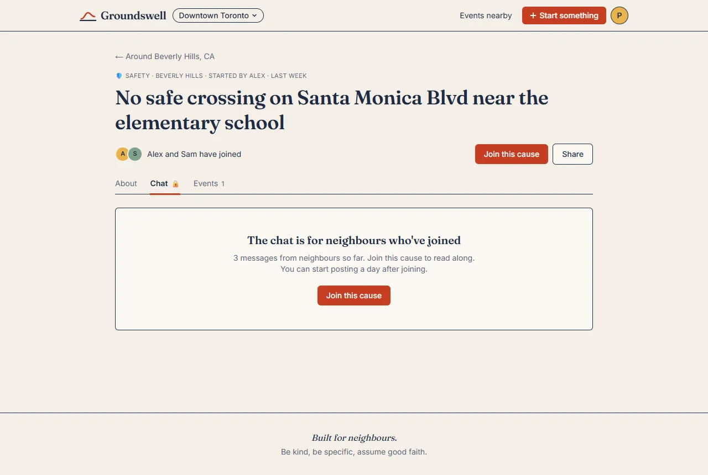 | 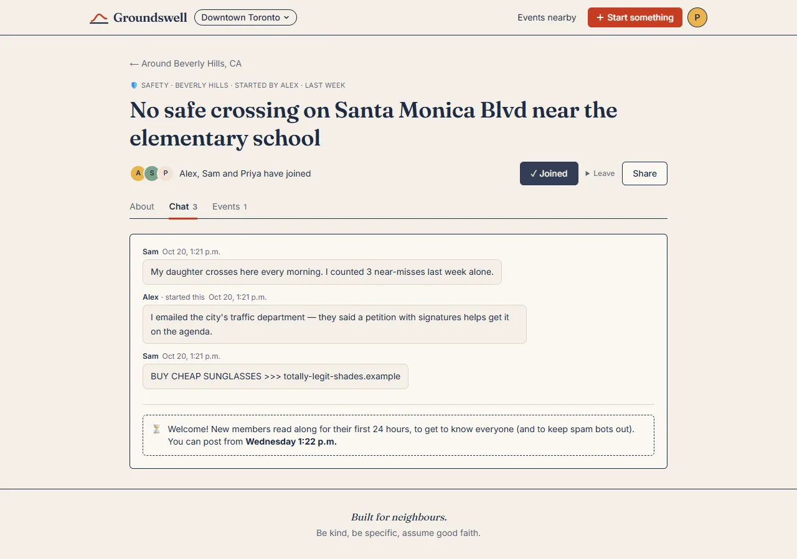 |

A member past the wait:

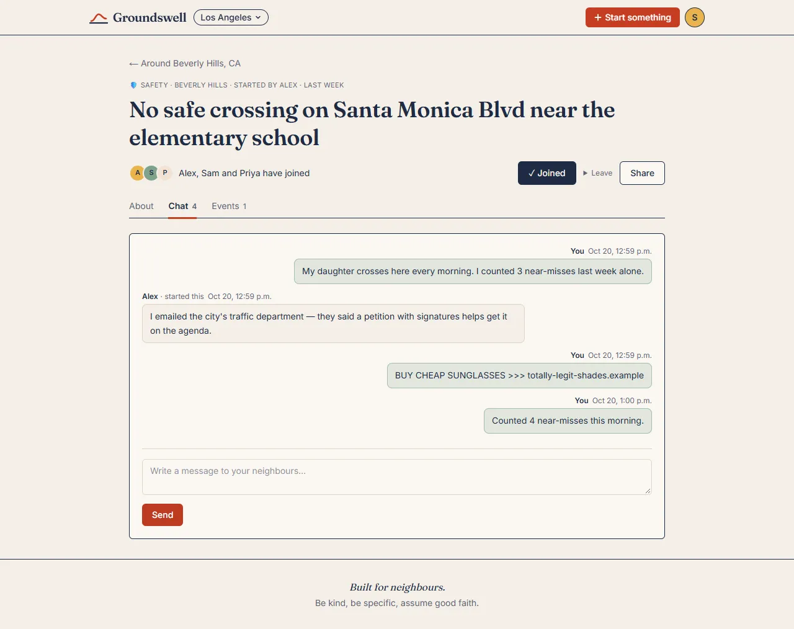

- Your own messages sit on the right in green; everyone else's on the left. Hover over someone else's message to **Report** it.
- **Why the 24-hour wait:** it gives newcomers a day to get a feel for the conversation, and it stops bots that join and spam straight away. Reading, RSVPing and signing aren't held back, only posting in the chat.
- **Other rules:** a confirmed email is needed to post. New accounts (first 24 hours) can post 10 messages an hour and no links; established accounts 60 an hour with up to 3 links. The same message twice within 10 minutes is refused.
- The server checks all of this on every message, so the rules can't be dodged by skipping the page.
- **Not live yet:** for now, new messages appear when you send one or reload. Instant, WhatsApp-style delivery (through Cloudflare) is the next phase of the build.

### Events

Every event belongs to a cause. The Events tab lists them, each with the date and time **in your own time zone**, the place (or "Online"), who's hosting, how many are going, and **I'll be there** (it becomes **✓ Going**, or **Full** if there's a capacity and it's reached).

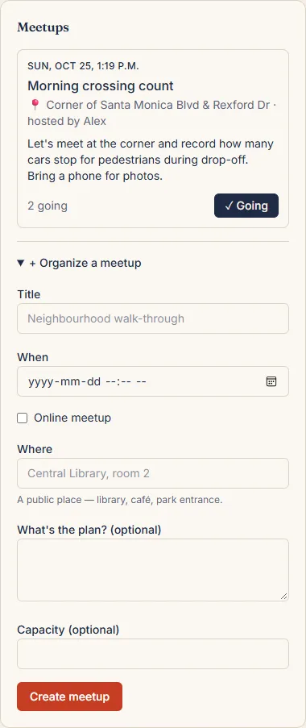

- **+ Organize an event** opens the form: title, when, where (a public place is suggested), an optional plan, and an optional capacity. Tick **Online meetup** and *Where* becomes *Video link*. **The link is only shown to people going**, so random visitors can't drop into the call.
- The host is automatically going and sees **✓ Hosting**.
- **Can't host it?** → **Step down as host** passes the event to the first person who RSVP'd (who gets an email), or cancels it if nobody else is going. The event then shows *"hosted by Sam (took over)."*

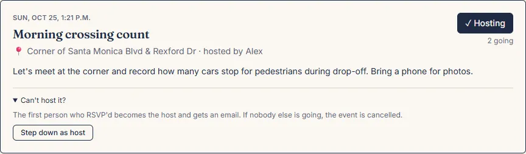

**Rules:** confirmed email needed to organize; 10 events an hour (2 for new accounts); the time must be in the future. Only events still to come (and ones that started in the last 6 hours) are listed.

---
## 4. Raise an issue

`/issues/new` (from **Start something** in the top bar, or **+ Raise an issue here** on an area page)

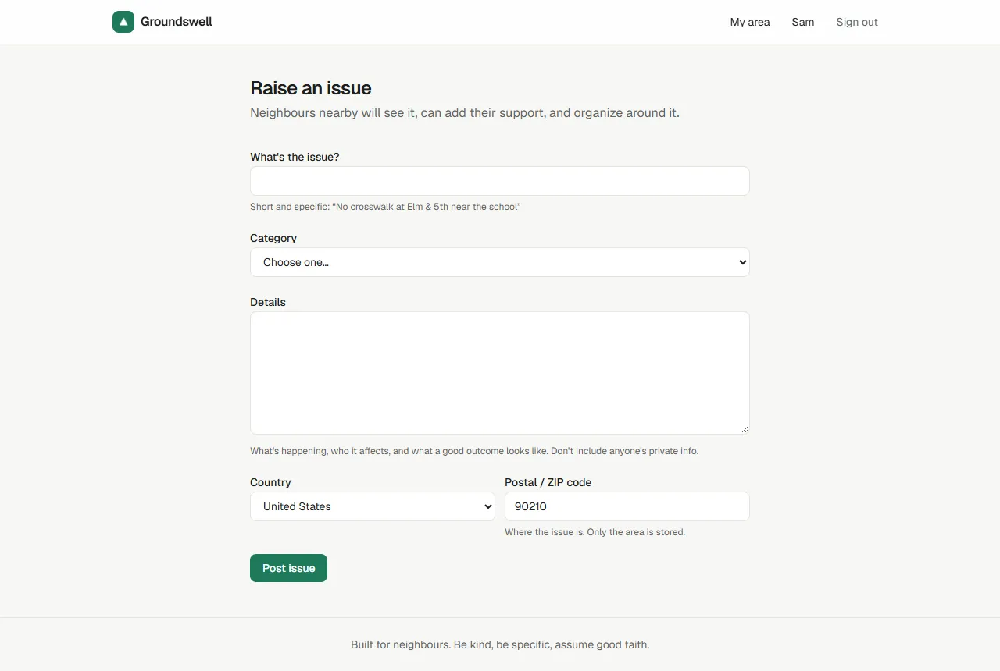

- **What's the issue?** A short, specific title (8–120 characters).
- **Category:** one of the ten.
- **Details:** what's happening, who it affects, and what a good outcome looks like (20–5,000 characters). The hint reminds people not to include anyone's private information.
- **Country and postal code:** filled in from the area you came from. Only the area is stored.
- **Post issue** creates it, counts the author as its first supporter, and opens the new issue page.

**Rules:** confirmed email needed; 10 issues an hour (2 for new accounts); new accounts can't include links.

---

## 5. Join, sign in and forgot password

| Join (`/signup`) | Sign in (`/signin`) |
|---|---|
| 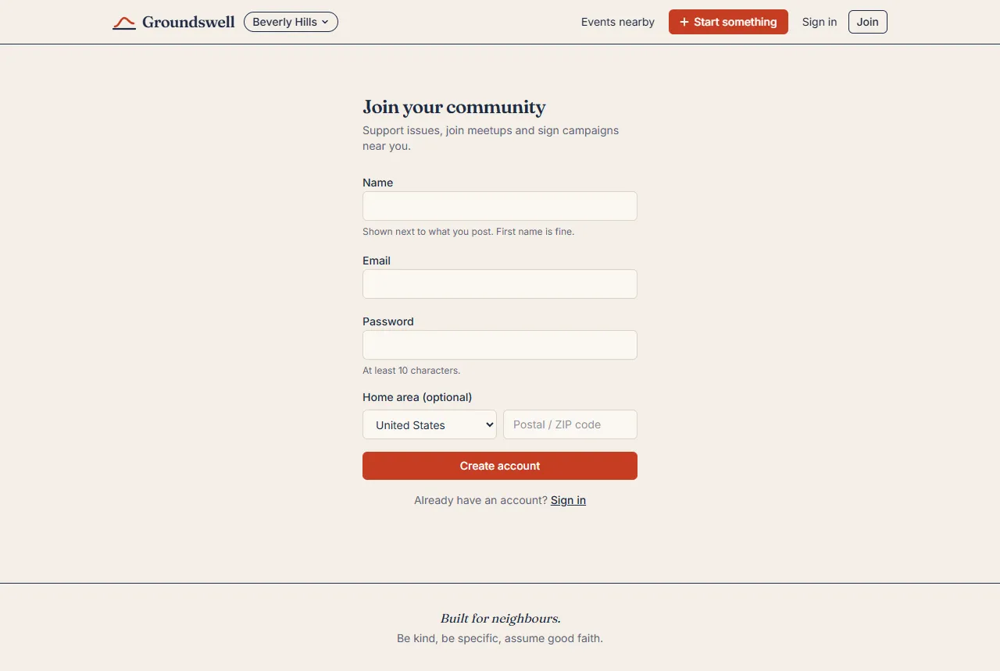 | 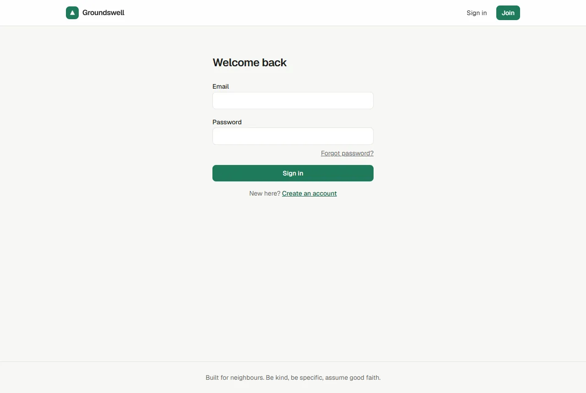 |

**Join** asks for a name (shown on posts; a first name is fine), email, a password of at least 10 characters, and an optional home area. Then:

1. The account is created and you're signed in straight away.
2. A **"Confirm your email"** message is sent (on your PC it's printed in the terminal instead). The link works for 48 hours.
3. Until you click it, you can browse, support issues and RSVP, but not post, sign or report. The yellow bar reminds you.

**Sign in** takes you back to the page you were on. After 10 wrong tries on one account (or 20 from one connection) within 15 minutes, it asks you to wait.

**Forgot password?** (`/forgot-password`) emails a reset link that works for 1 hour. It always answers *"If there's an account for that email, a reset link is on its way,"* whether or not the address is registered, so nobody can use it to find out who's a member. Setting a new password signs you out on every device.

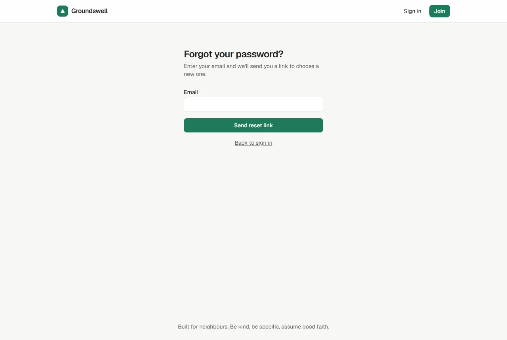

**Coming later:** once their keys are added, **Sign in with Google** and **Sign in with Apple** buttons appear on both forms automatically, and the Cloudflare "are you human?" check appears too (usually invisible). See [Security and spam](security-and-spam.md).

---

## 6. Your activity (`/me`)

Click your name in the top bar.

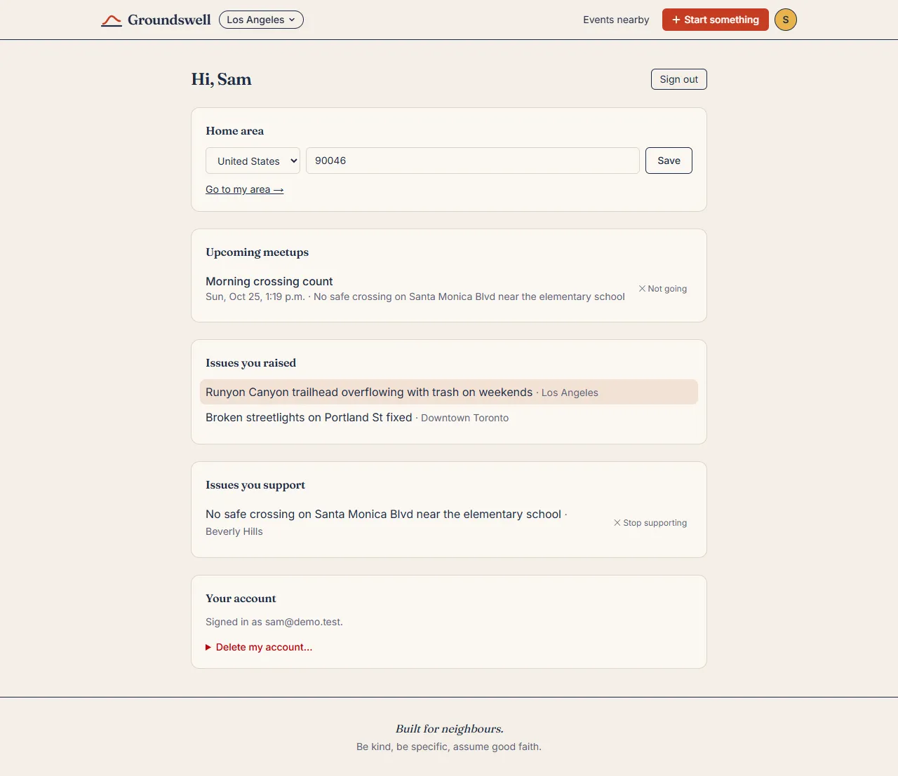

- **Sign out** at the top right.
- **Home area:** set or change your postal code. The top bar falls back to it when you haven't looked at another area.
- **Upcoming meetups** you've RSVP'd to, with times in your time zone. **✕ Not going** cancels your RSVP. Meetups you host are tagged **Hosting**, with a **Manage** link to the meetup (stepping down is confirmed there).
- **Issues you raised.** If a moderator hid or removed one, it shows an **Under review** or **Removed** tag here.
- **Issues you support**, each with **✕ Stop supporting**.
- **Your account:** your sign-in email, and **Delete my account…** (below).
- **Admins also see** a **Moderation queue** box at the top with the number of open reports.

### Deleting your account

**Delete my account…** opens a plain explanation of what will happen, and asks for your password:

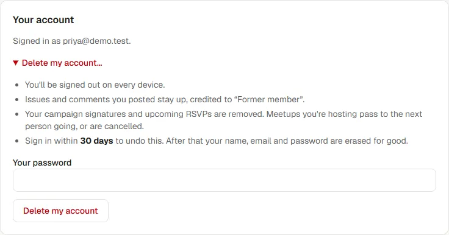

After confirming, you're signed out everywhere and land on this page:

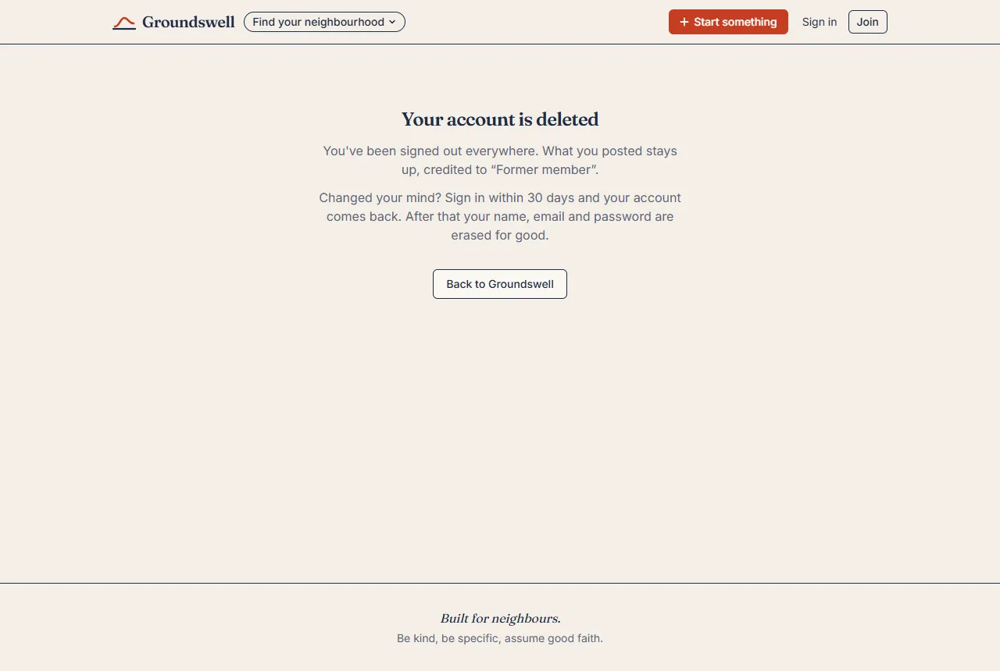

- **Right away:** everything you posted shows **"Former member"** instead of your name. Your campaign signatures and upcoming RSVPs are removed, and meetups you were hosting are handed on or cancelled. Your "I care" clicks stay as anonymous numbers.
- **Changed your mind?** Sign in within **30 days** and the account comes back, with a "Welcome back" note. (Removed signatures and RSVPs aren't restored.)
- **After 30 days:** your name, email, password and home area are erased for good by the daily clean-up job. Your posts stay, so the conversations still make sense, and your email is free to sign up again.

---

## 7. Reporting and the moderation queue (admins)

### How reporting works

1. Any member with a confirmed email can click **Report** on an issue or a comment (not their own).
2. The report goes into the moderation queue. Up to 20 reports an hour per person.
3. If **3 different accounts that are over a day old** report the same thing, it's **hidden automatically** until an admin decides. The author still sees it, with a note that it's under review.

### The moderation queue

`/admin/reports`. Only admins can see it; everyone else gets "page not found." (How to make someone an admin: [Day to day](day-to-day.md#making-someone-an-admin).)

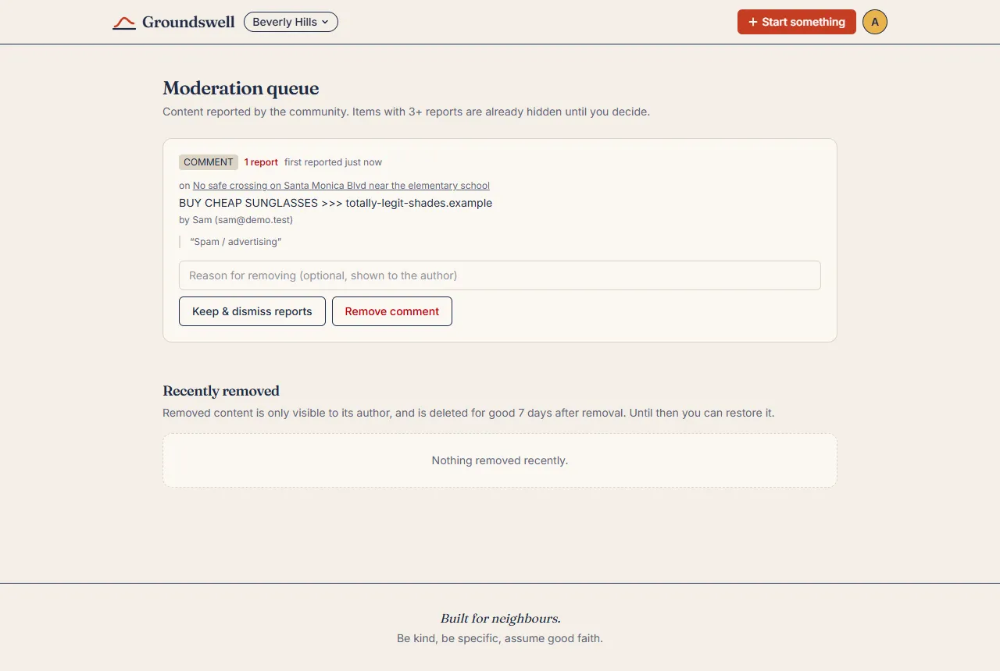

Each reported item shows its type, number of reports, when it was first reported, the content and who wrote it, and the reporters' reasons. Then:

- **Keep & dismiss reports** (or **Restore** if it was auto-hidden): it stays, and the reports are closed.
- **Remove comment / issue:** optionally type a reason first (the author will see it), then click.

### After removing: undo for 7 days

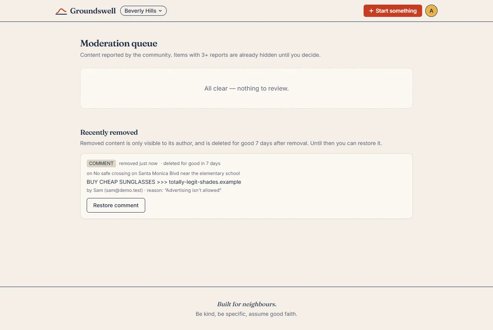

Removed content moves to **Recently removed**, which shows when it was removed, when it will be deleted for good, the reason, and a **Restore** button.

Meanwhile, the **author** sees this under their removed comment (or at the top of a removed issue). Nobody else sees the content at all:

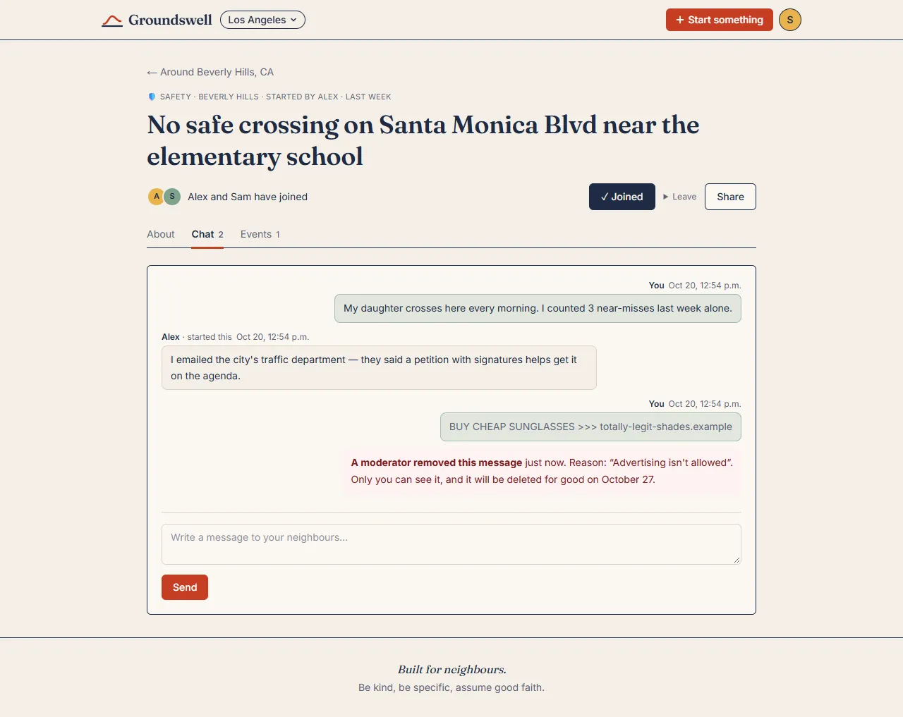

After **7 days**, the daily clean-up job on Vercel deletes it permanently. Deleting an issue also deletes its comments, meetups and campaigns. Every decision (kept, removed, restored) is recorded with who did it and when.

---

## 8. On a phone, and installing the app

The whole site is designed to work on phones first:

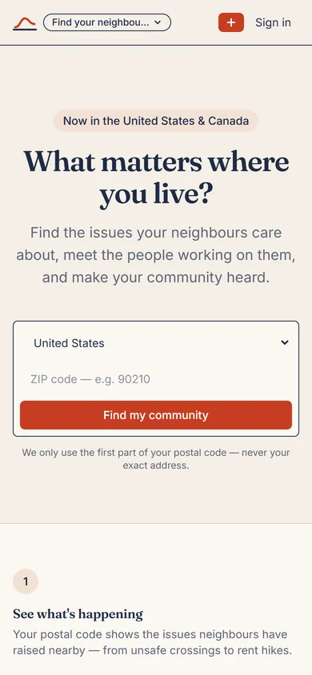
&nbsp;
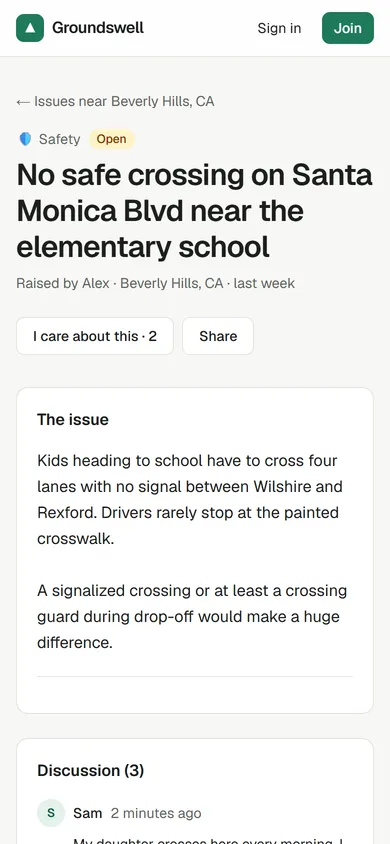

**Installing:** Groundswell can be added to a phone's home screen like an app (it's a "PWA"):

- **Android / Chrome / Edge:** a small "Get the Groundswell app" card appears at the bottom with an **Install** button.
- **iPhone (Safari):** the card explains *Share → Add to Home Screen*, since Apple doesn't allow a button.
- Dismiss it with ✕ and it won't come back on that device.

Installed, it opens full-screen with its own icon. It only stores the app's design files on the phone, never pages or anyone's data, so nobody sees stale or someone else's information.

---

## 9. Small pages

| Not found | Offline |
|---|---|
| 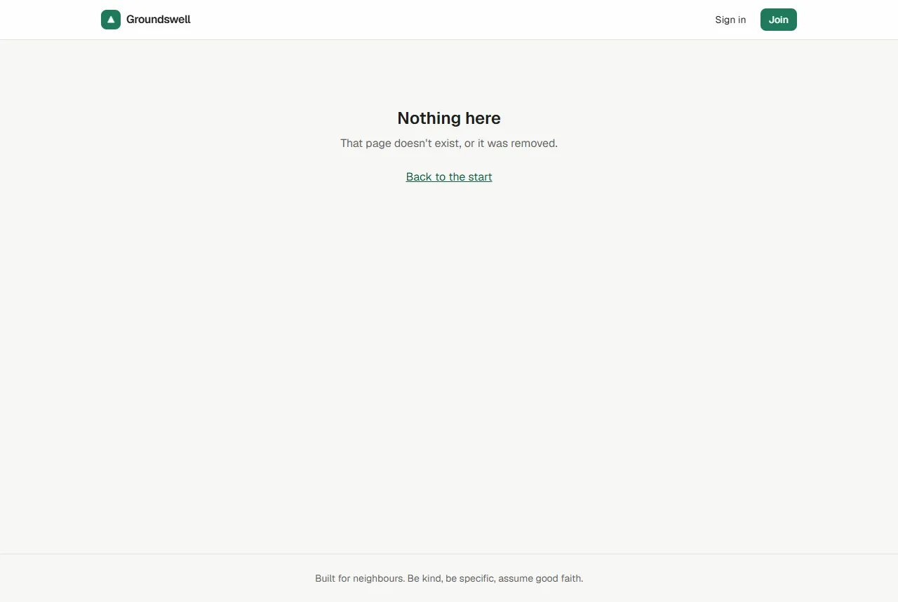 | 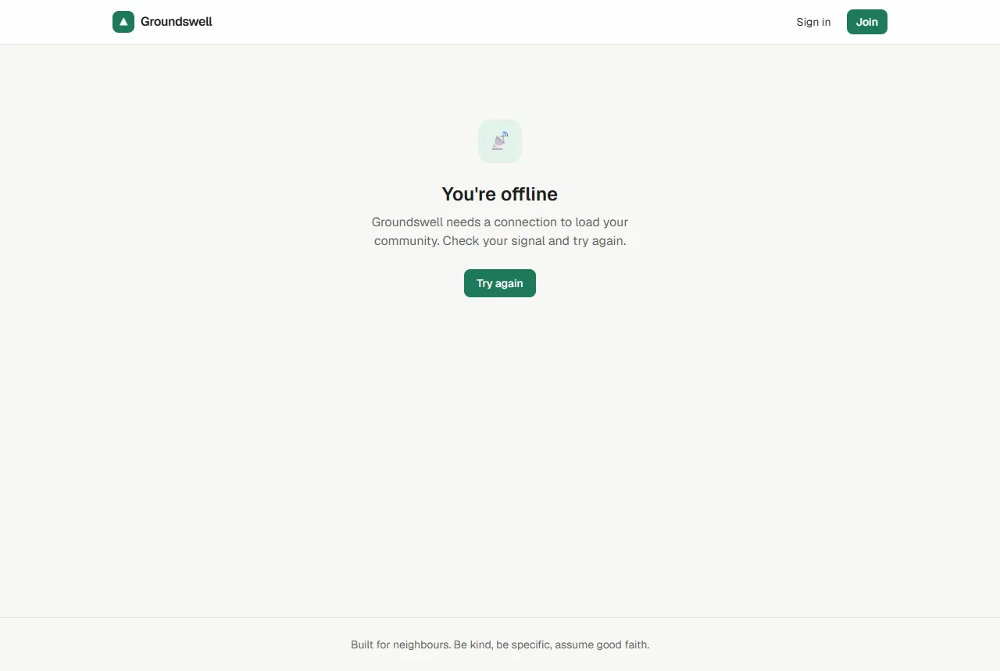 |

- **Not found** appears for a mistyped address, a deleted or removed issue, or a non-admin trying `/admin/reports`.
- **You're offline** appears when the installed app is opened without a connection, instead of the browser's error page.

---

## 10. Who can do what

| Action | Visitor | Signed in | Email confirmed | Issue author | Admin |
|---|:-:|:-:|:-:|:-:|:-:|
| Browse areas, issues, meetups, campaigns | ✓ | ✓ | ✓ | ✓ | ✓ |
| Look up representatives | ✓ | ✓ | ✓ | ✓ | ✓ |
| Join a cause, RSVP | | ✓ | ✓ | ✓ | ✓ |
| Read a cause's chat | | members | members | ✓ | ✓ (to moderate) |
| Post in a cause's chat | | | members of 24 h+ | ✓ | members of 24 h+ |
| Raise issues, organize events, start campaigns | | | ✓ | ✓ | ✓ |
| Sign campaigns, report content | | | ✓ | ✓ | ✓ |
| Remove own signature or RSVP; leave a cause | | ✓ | ✓ | ✓ | ✓ |
| Step down as an event's host | | ✓ (host) | ✓ (host) | ✓ (host) | ✓ (host) |
| Delete own account | | ✓ | ✓ | ✓ | ✓ |
| Change an issue's status | | | | ✓ | |
| See their own hidden/removed posts (with a notice) | | | | ✓ | |
| Moderation queue: keep, remove, restore | | | | | ✓ |

The posting limits, link rules and everything else that protects the site are explained in [Security and spam](security-and-spam.md).

---

*To refresh these screenshots after a design change: reseed the dev database (`npm run db:seed`), run the dev server, and retake the pictures at 1280 px wide (phones at 390 px). Save them as WebP in `docs/images/walkthrough/`, keeping the same file names.*
